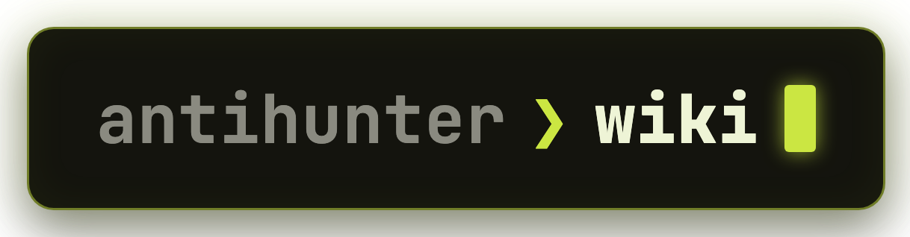
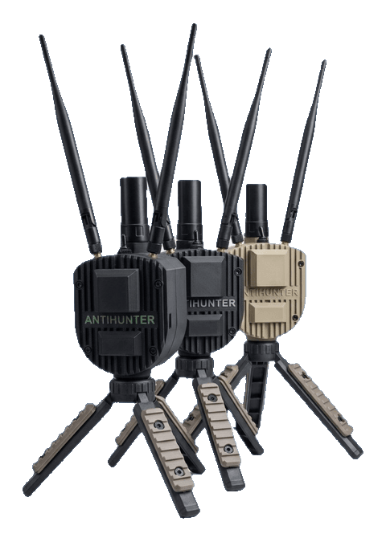
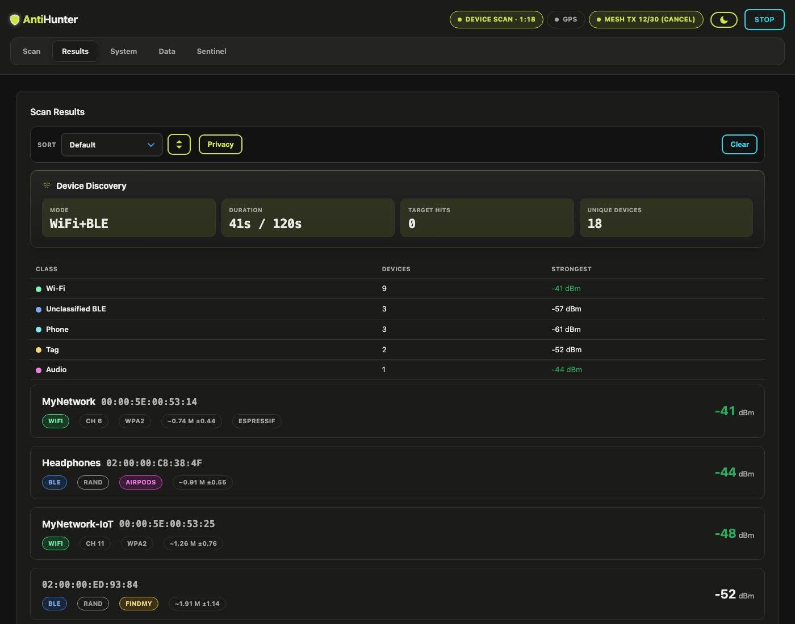

  

 

  

---

## What is AntiHunter?

**Hunt the hunters.**

AntiHunter is a small, battery-powered digital and physical tripwire. Leave one in a home, a vehicle, along a fence line, or at a site with no signal. It watches every wireless device around it, flags the ones that do not belong, and sends the alert over its own long-range mesh radio to your phone and your other nodes. It needs no internet or subscription, it is open source, and it never jams or attacks anything.

  

<i>Featured in Seeed Studio's <a href="https://www.seeedstudio.com/blog/2026/01/29/best-xiao-projects/">Best 20 XIAO Projects in 2025</a>.</i>

---

## What it does

- **Hunt your watchlist.** Alerts the moment a MAC, vendor, or network name on your list shows up.
- **Know who belongs.** Learns a site, then flags new, returning, and moving devices.
- **Catch Wi-Fi attacks.** Spots deauth floods, fake access points, and handshake capture, and names the attack tool it recognizes.
- **Track drones.** Reads each drone's ID, position, altitude, and speed, and its pilot's position if the drone sends it.
- **Unmask rotating MACs.** Links a phone's changing addresses back to one device.
- **Guard the node.** Feels anyone moving it and can respond with a scan, a recording, or a wipe. Senses people moving nearby, even through a wall.
- **Run a fleet.** Start and stop scans on every node from any one of them, split one scan across the mesh, and locate a device with three GPS nodes.

  

The [wiki](https://github.com/lukeswitz/AntiHunter/wiki) covers everything else. Start with:

- [Choose your hardware](https://github.com/lukeswitz/AntiHunter/wiki/Choose-your-hardware)
- [Flash a node](https://github.com/lukeswitz/AntiHunter/wiki/Flash-a-node)
- [First setup](https://github.com/lukeswitz/AntiHunter/wiki/First-setup)
- [Field exercises](https://github.com/lukeswitz/AntiHunter/wiki#field-exercises)
- [Troubleshooting](https://github.com/lukeswitz/AntiHunter/wiki/Troubleshooting)

---

## Contributing

Ask questions and share builds in [Discussions](https://github.com/lukeswitz/AntiHunter/discussions) or on [Discord](https://discord.gg/AYFzUurfmh). Report bugs in [Issues](https://github.com/lukeswitz/AntiHunter/issues). Pull requests are welcome. See [CONTRIBUTING.md](CONTRIBUTING.md).

## Acknowledgments

Original concept and hardware design by @TheRealSirHaXalot.

This project includes code from [opendroneid-core-c](https://github.com/opendroneid/opendroneid-core-c), licensed under the Apache License 2.0. Copyright © Intel Corporation and OpenDroneID contributors.

## License

Firmware: [GNU Affero General Public License v3.0](LICENSE). Hardware and documentation: as stated in their files.

## Legal disclaimer

AntiHunter is for lawful, authorized defensive use only, on infrastructure, networks, devices, radio spectrum, and datasets that you own or have written permission to assess. The [full disclaimer](docs/legal-disclaimer.md) covers radio and interception law, privacy, drone Remote ID, computer misuse, export rules, and the warranty limitations. Flashing the firmware is acceptance of those terms. If you do not agree, do not build, flash, assemble, deploy, or operate AntiHunter.
