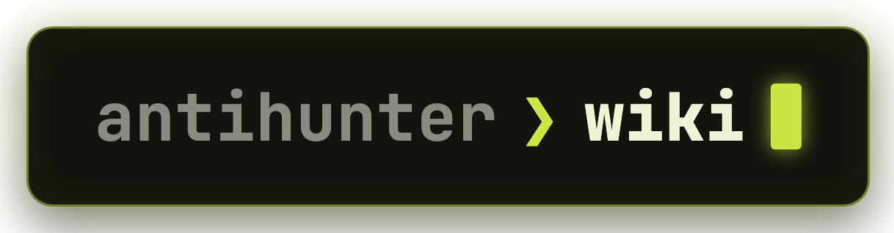

<p align="center">
  
</p>

<div align="center">

[](https://github.com/lukeswitz/AntiHunter/releases/latest)
[](https://github.com/lukeswitz/AntiHunter/releases)
[](https://github.com/lukeswitz/AntiHunter/releases)
[](https://discord.gg/AYFzUurfmh)</br>
[](https://github.com/lukeswitz/AntiHunter/actions/workflows/lint.yml)
[](https://github.com/lukeswitz/AntiHunter/actions/workflows/platformio.yml)
[](https://github.com/lukeswitz/AntiHunter/actions/workflows/github-code-scanning/codeql)

</div>

<div align="center">

  <a href="https://github.com/lukeswitz/AntiHunter/wiki"></a>

  <p><a href="#quick-start">Quick start</a> • <a href="https://lectronz.com/stores/antihunter">Get one</a> • <a href="https://github.com/TheRealSirHaXalot/AntiHunter-Command-Control-PRO">Command Center</a> • <a href="https://rootdowndigital.com/antihunter">Website</a> • <a href="https://rootdowndigital.com/privacy">Privacy policy</a></p>
</div>

---

## What is AntiHunter?

AntiHunter is a perimeter detection platform you set up and walk away from. Put a node in a bedroom, along a fence line, at an event, or in a cabin with no signal; it learns what belongs, then tells you when a new device shows up, when someone moves it, or when a Wi-Fi attack starts — naming the tool behind it. It runs on battery with no internet, no cloud, and no subscription, and your data stays on the device.

It's open source and listens only; it never jams or attacks anything. One node works alone. Add more and they compare notes over long-range LoRa radio, confirm each other's alerts, and with GPS put a signal on a map. Control a node from its web page, by text over the mesh, or from the [Command Center](https://github.com/TheRealSirHaXalot/AntiHunter-Command-Control-PRO).

<p align="center">
  
</p>

<p align="center"><i>Featured in Seeed Studio's <a href="https://www.seeedstudio.com/blog/2026/01/29/best-xiao-projects/">Best 20 XIAO Projects in 2025</a>.</i></p>

> [!TIP]
> Flash your first node with the [Quick start](#quick-start) below, then open the wiki's [First setup](https://github.com/lukeswitz/AntiHunter/wiki/First-setup) page to change the default password and keys. The [wiki](https://github.com/lukeswitz/AntiHunter/wiki) has every feature and troubleshooting in depth.

---

## What it detects

Each feature has its own wiki page with settings, mesh commands, and troubleshooting.

### Find devices

| Feature | What it does |
|---|---|
| [Target scan](https://github.com/lukeswitz/AntiHunter/wiki/Target-scan) | Alerts when it hears a MAC, vendor, or network name on your watchlist. |
| [Device discovery](https://github.com/lukeswitz/AntiHunter/wiki/Device-discovery) | Lists nearby Wi-Fi access points and Bluetooth devices. |
| [Device classifier](https://github.com/lukeswitz/AntiHunter/wiki/Device-classifier) | Labels each Bluetooth device by what it is, such as AirPods, a Tile tag, a drone, or a tire-pressure sensor, by reading its advertisement. |
| [Probe request scanner](https://github.com/lukeswitz/AntiHunter/wiki/Probe-requests) | Shows which network names each phone or laptop is looking for. |
| [Randomized MAC tracer](https://github.com/lukeswitz/AntiHunter/wiki/Randomized-MAC-tracer) | Links a phone's changing MAC addresses back to one device, using methods from peer-reviewed research. |
| [Drone Remote ID](https://github.com/lukeswitz/AntiHunter/wiki/Drone-Remote-ID) | Reads a drone's ID, position, flight data, and the operator's location. |
| [Triangulation](https://github.com/lukeswitz/AntiHunter/wiki/Triangulation) | Three or more nodes with GPS estimate where a device is. |

### Watch an area

| Feature | What it does |
|---|---|
| [Baseline anomaly](https://github.com/lukeswitz/AntiHunter/wiki/Baseline-anomaly) | Learns which devices belong, then reports new, missing, returning, and moving ones. |
| [CSI motion](https://github.com/lukeswitz/AntiHunter/wiki/CSI-motion) (Beta) | Detects people moving nearby, even through walls, from changes in Wi-Fi signals. |
| [Vibration and tamper response](https://github.com/lukeswitz/AntiHunter/wiki/Vibration-and-tamper) | When the node is moved, it alerts you and can start a scan or packet capture on its own. |

### Detect attacks

| Feature | What it does |
|---|---|
| [Sentinel](https://github.com/lukeswitz/AntiHunter/wiki/Sentinel) | Runs in the background and reports Wi-Fi attacks such as deauth floods, evil twins, and handshake capture. It names the tool when it recognizes one, such as Marauder, MDK4, or aireplay-ng. |
| [Connected client visibility](https://github.com/lukeswitz/AntiHunter/wiki/Sentinel) | Lists the devices that join the node's own access point. |
| [Mesh radio detection](https://github.com/lukeswitz/AntiHunter/wiki/Sentinel) | Finds other Meshtastic and MeshCore radios nearby, and audits the commands sent on your own mesh channel. |
| [Deauth detection](https://github.com/lukeswitz/AntiHunter/wiki/Deauth-detection) | Logs every deauth frame and flags floods. |

### Capture and respond

| Feature | What it does |
|---|---|
| [Packet capture](https://github.com/lukeswitz/AntiHunter/wiki/Packet-capture) | Saves Wi-Fi or Bluetooth traffic to SD as a file Wireshark opens. |
| [Scheduled scans](https://github.com/lukeswitz/AntiHunter/wiki/Scheduled-scans) | Runs a scan at a set time, once or every day. |
| [Secure wipe](https://github.com/lukeswitz/AntiHunter/wiki/Secure-wipe) | Erases the node's data on command, or on its own if someone tampers with it. |

---

## Node types

Every node runs the same detectors and shares one LoRa mesh. They differ in the radio and the sensor.

| Node | Board | Covers | Status |
|---|---|---|---|
| [DIGI](https://github.com/lukeswitz/AntiHunter/wiki/DIGI-node) | ESP32-S3 | Wi-Fi and Bluetooth, 2.4 GHz | Stable |
| [DIGI C5](https://github.com/lukeswitz/AntiHunter/wiki/DIGI-C5) | ESP32-C5 | Wi-Fi and Bluetooth, 2.4 and 5 GHz | Testing |
| [RadarNode](https://github.com/lukeswitz/AntiHunter/wiki/RadarNode) | ESP32-C5 | 24 GHz radar, then a Wi-Fi and Bluetooth sweep | Experimental |
| SDR node | ESP32-S3 | Wideband radio capture | In development |
| [Command Center](https://github.com/TheRealSirHaXalot/AntiHunter-Command-Control-PRO) | Server | A whole fleet on one map | Beta |

---

## Quick start

1. **Attach all three antennas** before you power on.
2. **Flash the firmware** from the [Web Flasher](https://lukeswitz.github.io/AntiHunter/) in Chrome or Edge on a desktop. Pick **Full** (with the web UI) or **Headless** (mesh and serial only). See [Full or Headless](https://github.com/lukeswitz/AntiHunter/wiki/Full-or-Headless).
3. **Connect.** For Full, join the `Antihunter` Wi-Fi network (password `antihunt3r123`), open `http://192.168.4.1`, and log in as `admin` with the same password. For Headless, open a serial monitor at 115200 baud.
4. **Set the radio's LoRa region.** Without it, the radio never transmits. See [Meshtastic radio setup](https://github.com/lukeswitz/AntiHunter/wiki/Meshtastic-radio-setup).
5. **Lock it down.** Every unit comes with the same published defaults, so change them: the access point name and password, the node ID, the Meshtastic channel, and the erase key. See [First setup](https://github.com/lukeswitz/AntiHunter/wiki/First-setup).
6. **Run a scan.** Scan only where you have permission. See the [legal disclaimer](#legal-disclaimer).

The [wiki](https://github.com/lukeswitz/AntiHunter/wiki) covers each step in detail.

---

## Documentation

- [Wiki](https://github.com/lukeswitz/AntiHunter/wiki): setup, every feature, and troubleshooting
- [Mesh command reference](docs/mesh-commands.md): every command, value, and alert
- [HTTP API reference](docs/api-reference.md): the Full firmware's endpoints
- [Operator's Guide (PDF)](docs/AntiHunter-Operators-Guide.pdf): unboxing to deployment, with a printable quick-reference card

---

## Hardware

Buy a node from the [store](https://lectronz.com/stores/antihunter), or build one from the [bill of materials](hw/Prototype_STL_Files/BOM-Links.md). The [Hardware and BOM](https://github.com/lukeswitz/AntiHunter/wiki/Hardware-and-BOM) wiki page lists the parts, the pinout, and the enclosure files.

> [!IMPORTANT]
> Use a regulated 5 V supply. Unregulated batteries cause voltage instability.

A node is built from a Seeed XIAO ESP32-S3 (or a XIAO ESP32-C5 for 5 GHz), a Meshtastic board (Heltec V3.2 or T114), a GPS module, an SD card, a vibration sensor, and a real-time clock.

---

## Build from source

You need PlatformIO, Git, and a USB cable.

```bash
git clone https://github.com/lukeswitz/AntiHunter.git
cd AntiHunter
pio run -e AntiHunter-full -t upload        # Full: web UI on its own access point
pio run -e AntiHunter-headless -t upload    # Headless: serial and mesh only
```

The first build downloads about 6 GB of tools. The ESP32-C5 builds are on the `feat/c5` branch. See [Build from source](https://github.com/lukeswitz/AntiHunter/wiki/Build-from-source).

---

## Contributing

Ask questions and share builds in [Discussions](https://github.com/lukeswitz/AntiHunter/discussions) or on [Discord](https://discord.gg/AYFzUurfmh). Report bugs in [Issues](https://github.com/lukeswitz/AntiHunter/issues). Pull requests are welcome. See [CONTRIBUTING.md](CONTRIBUTING.md).

## Acknowledgments

Original concept and hardware design by @TheRealSirHaXalot.

This project includes code from [opendroneid-core-c](https://github.com/opendroneid/opendroneid-core-c), licensed under the Apache License 2.0. Copyright © Intel Corporation and OpenDroneID contributors.

## License

Firmware: [GNU Affero General Public License v3.0](LICENSE). Hardware and documentation: as stated in their files.

## Legal disclaimer

AntiHunter is for lawful, authorized defensive use only, on infrastructure, networks, devices, radio spectrum, and datasets that you own or have written permission to assess. The [full disclaimer](docs/legal-disclaimer.md) covers radio and interception law, privacy, drone Remote ID, computer misuse, export rules, and the warranty limitations. Flashing the firmware is acceptance of those terms. If you do not agree, do not build, flash, assemble, deploy, or operate AntiHunter.
