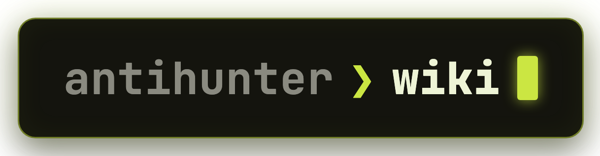
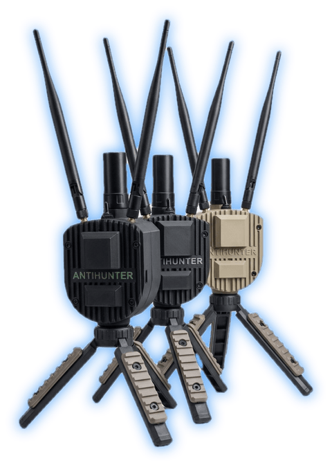

<p align="center">
  
</p>

<div align="center">

[](https://github.com/lukeswitz/AntiHunter/releases/latest)
[](https://github.com/lukeswitz/AntiHunter/releases)
[](https://github.com/lukeswitz/AntiHunter/releases)
[](https://discord.gg/AYFzUurfmh)</br>
[](https://github.com/lukeswitz/AntiHunter/actions/workflows/lint.yml)
[](https://github.com/lukeswitz/AntiHunter/actions/workflows/platformio.yml)
[](https://github.com/lukeswitz/AntiHunter/actions/workflows/github-code-scanning/codeql)

</div>

<div align="center">

  <a href="https://github.com/lukeswitz/AntiHunter/wiki"></a>
</div>

---

## Contents

- [What is AntiHunter?](#what-is-antihunter)
- [Quick start](#quick-start)
- [What it detects](#what-it-detects)
- [Node types](#node-types)
- [Hardware](#hardware)
- [Documentation](#documentation)
- [Flash from the command line](#flash-from-the-command-line)
- [Build from source](#build-from-source)
- [Contributing](#contributing)
- [License](#license)
- [Legal disclaimer](#legal-disclaimer)

---

## What is AntiHunter?

AntiHunter is a small, battery-powered digital and physical tripwire. Leave it in a home, a vehicle, along a fence line, or at a site with no signal. It watches the Wi-Fi and Bluetooth around it and its own surroundings, and tells you what is there and what changes:

- **See what is around you.** It lists nearby Wi-Fi networks and devices with their signal, vendor, and security, classifies Bluetooth devices by type, and records the networks that devices search for.
- **Watch for change.** It learns which devices belong at a site and alerts on new, returning, or moving ones and on devices from your target list. It links the changing random addresses of phones back to one device.
- **Detect drones.** It decodes drone Remote ID over Wi-Fi and Bluetooth, including Bluetooth long range.
- **Detect Wi-Fi attacks.** It spots deauthentication, fake access points, handshake capture, jamming, and other attacks, and names the tool when it recognizes one.
- **Sense movement and tampering.** It senses movement nearby, even through a wall, from Wi-Fi [channel state information (CSI)](https://en.wikipedia.org/wiki/Channel_state_information), and by default it never transmits to do so. It also knows when someone moves the node. It can then start a scan or a recording, or wipe its data.
- **Locate and record.** Three or more nodes with GPS can put a device on a map. It can capture packets to its SD card, and scans can run on a schedule.

Its onboard LoRa radio sends alerts over Meshtastic or MeshCore to the other nodes and radios on your channel and to the [Command Center](https://github.com/TheRealSirHaXalot/AntiHunter-Command-Control-PRO), with no internet or subscription. You control it from the web UI (Full build), over the mesh, or over USB. AntiHunter is open source and never jams or attacks anything.

<p align="center">
  
</p>

<p align="center"><i>Featured in Seeed Studio's <a href="https://www.seeedstudio.com/blog/2026/01/29/best-xiao-projects/">Best 20 XIAO Projects in 2025</a>.</i></p>

---

## Quick start

1. **Attach all three antennas** before you power on.
2. **Flash the firmware** from the [Web Flasher](https://lukeswitz.github.io/AntiHunter/) in Chrome or Edge on a desktop. Pick **Full** (with the web UI) or **Headless** (mesh and serial only). See [Full or Headless](https://github.com/lukeswitz/AntiHunter/wiki/Full-or-Headless). On macOS or Linux you can use the [flasher script](#flash-from-the-command-line) instead.
3. **Connect.** For Full, join the `Antihunter` Wi-Fi network (password `antihunt3r123`), open `http://192.168.4.1`, and log in as `admin` with the same password. For Headless, open a serial monitor at 115200 baud.
4. **Set the radio's LoRa region.** Without it, the radio never transmits. See [Meshtastic radio setup](https://github.com/lukeswitz/AntiHunter/wiki/Meshtastic-radio-setup) or [MeshCore radio setup](https://github.com/lukeswitz/AntiHunter/wiki/MeshCore-radio-setup).
5. **Lock it down.** Every unit has the same published defaults. Change the access point name and password, the node ID, the Meshtastic channel, and the erase key. See [First setup](https://github.com/lukeswitz/AntiHunter/wiki/First-setup).
6. **Run a scan.** Scan only where you have permission. See the [legal disclaimer](#legal-disclaimer).

The [wiki](https://github.com/lukeswitz/AntiHunter/wiki) covers each step in detail.

---

## What it detects

Each feature has its own wiki page with settings, mesh commands, and troubleshooting.

### Find devices

| Feature | What it does |
|---|---|
| [Target scan](https://github.com/lukeswitz/AntiHunter/wiki/Target-scan) | Alerts when it hears a MAC, vendor, or network name on your watchlist. |
| [Device discovery](https://github.com/lukeswitz/AntiHunter/wiki/Device-discovery) | Lists nearby Wi-Fi access points and Bluetooth devices. |
| [Device classifier](https://github.com/lukeswitz/AntiHunter/wiki/Device-classifier) | Reads each Bluetooth advertisement and labels the device, such as AirPods, a Tile tag, a drone, or a tire-pressure sensor. |
| [Probe request scanner](https://github.com/lukeswitz/AntiHunter/wiki/Probe-requests) | Shows which network names each phone or laptop is looking for. |
| [Randomized MAC tracer](https://github.com/lukeswitz/AntiHunter/wiki/Randomized-MAC-tracer) | Links a phone's changing MAC addresses back to one device, using methods from peer-reviewed research. |
| [Drone Remote ID](https://github.com/lukeswitz/AntiHunter/wiki/Drone-Remote-ID) | Reads a drone's ID, position, flight data, and the operator's location. |
| [Triangulation](https://github.com/lukeswitz/AntiHunter/wiki/Triangulation) | Three or more nodes with GPS estimate where a device is. |

### Watch an area

| Feature | What it does |
|---|---|
| [Baseline anomaly](https://github.com/lukeswitz/AntiHunter/wiki/Baseline-anomaly) | Learns which devices belong, then reports new, missing, returning, and moving ones. |
| [CSI motion](https://github.com/lukeswitz/AntiHunter/wiki/CSI-motion) (Beta) | Detects people moving nearby, even through walls, from changes in Wi-Fi signals. |
| [Vibration and tamper response](https://github.com/lukeswitz/AntiHunter/wiki/Vibration-and-tamper) | When the node is moved, it alerts you and can start a scan or packet capture on its own. |

### Detect attacks

| Feature | What it does |
|---|---|
| [Sentinel](https://github.com/lukeswitz/AntiHunter/wiki/Sentinel) | Reports Wi-Fi attacks in the background, such as deauth floods, evil twins, and handshake capture. It names the attack tool when it recognizes one, such as Marauder, MDK4, or aireplay-ng. |
| [Connected client visibility](https://github.com/lukeswitz/AntiHunter/wiki/Sentinel) | Lists the devices that join the node's own access point. |
| [Mesh radio detection](https://github.com/lukeswitz/AntiHunter/wiki/Sentinel) | Finds other Meshtastic and MeshCore radios nearby, and audits the commands sent on your own mesh channel. |
| [Deauth detection](https://github.com/lukeswitz/AntiHunter/wiki/Deauth-detection) | Logs every deauth frame and flags floods. |

### Capture and respond

| Feature | What it does |
|---|---|
| [Packet capture](https://github.com/lukeswitz/AntiHunter/wiki/Packet-capture) | Saves Wi-Fi or Bluetooth traffic to SD as a file Wireshark opens. |
| [Scheduled scans](https://github.com/lukeswitz/AntiHunter/wiki/Scheduled-scans) | Runs a scan at a set time, once or every day. |
| [Secure wipe](https://github.com/lukeswitz/AntiHunter/wiki/Secure-wipe) | Erases the node's data on command, or on its own if someone tampers with it. |

---

## Node types

Every node runs the same detectors and shares one LoRa mesh. They differ in the radio and the sensor.

| Node | Board | Covers | Status |
|---|---|---|---|
| [DIGI](https://github.com/lukeswitz/AntiHunter/wiki/DIGI-node) | ESP32-S3 | Wi-Fi and Bluetooth, 2.4 GHz | Stable |
| [DIGI C5](https://github.com/lukeswitz/AntiHunter/wiki/DIGI-C5) | ESP32-C5 | Wi-Fi and Bluetooth, 2.4 and 5 GHz | Testing |
| [RadarNode](https://github.com/lukeswitz/AntiHunter/wiki/RadarNode) | ESP32-C5 | 24 GHz radar, then a Wi-Fi and Bluetooth sweep | Experimental |
| SDR node | ESP32-S3+C5, nRF24, CC1001, M.2 | Wideband radio capture | In development |
| [Command Center](https://github.com/TheRealSirHaXalot/AntiHunter-Command-Control-PRO) | Server | A whole fleet on one map | Beta |

---

## Hardware

- [Store](https://lectronz.com/stores/antihunter): ready-made nodes and kits
- [Bill of materials](hw/Prototype_STL_Files/BOM-Links.md): the full parts list for one node, with where to buy each part
- [Assembly Manual (PDF)](hw/Prototype_STL_Files/Antihunter-DIGINODE-AssemblyManual.pdf): soldering, SD card setup, connectors, and the 3D-printed case
- [Hardware and BOM](https://github.com/lukeswitz/AntiHunter/wiki/Hardware-and-BOM) on the wiki: the pinout and the case files

> [!IMPORTANT]
> Use a regulated 5 V supply. Unregulated batteries cause voltage instability.

---

## Documentation

Start with the [wiki](https://github.com/lukeswitz/AntiHunter/wiki). It covers setup, every feature, and troubleshooting.

- [Start Here](docs/README.md): setup order, common questions, and fixes
- [Mesh command reference](docs/mesh-commands.md): every command, value, and alert
- [HTTP API reference](docs/api-reference.md): the Full firmware's endpoints
- [Operator's Guide (PDF)](docs/AntiHunter-Operators-Guide.pdf): unboxing to deployment, with a printable quick-reference card
- [Assembly Manual (PDF)](https://github.com/lukeswitz/AntiHunter/blob/main/hw/Prototype_STL_Files/Antihunter-DIGINODE-AssemblyManual.pdf): building the DIGINODE V4, with soldering, SD card setup, connectors, and the 3D-printed case
- Tier notes (PDF), one per kit:
  - [Tier 1 Assembled](docs/note-tier1-assembled.pdf)
  - [Tier 2 Parts Kit](docs/note-tier2-parts-kit.pdf)
  - [Tier 3 Populated PCB](docs/note-tier3-populated-pcb.pdf)
  - [Tier 4 Bare PCB](docs/note-tier4-bare-pcb.pdf)
- [Enclosure STL files](hw/Prototype_STL_Files): the 3D-printable case
- [Welcome letter](hw/Prototype_STL_Files/ahwelcome.txt): first steps for a new node

---

## Flash from the command line

The flasher script downloads the firmware and flashes it over USB:

```bash
curl -fsSL -o flashAntihunter.sh https://raw.githubusercontent.com/lukeswitz/AntiHunter/main/Dist/flashAntihunter.sh
chmod +x flashAntihunter.sh
./flashAntihunter.sh        # -e erases first, -c sets device parameters, -l lists firmware
```

See [Flash a node](https://github.com/lukeswitz/AntiHunter/wiki/Flash-a-node) for every option.

---

## Build from source

You need PlatformIO, Git, and a USB cable.

```bash
git clone https://github.com/lukeswitz/AntiHunter.git
cd AntiHunter
git checkout beta
pio run -e AntiHunter-full -t upload        # Full: web UI on its own access point
pio run -e AntiHunter-headless -t upload    # Headless: serial and mesh only
```

The ESP32-C5 builds are on the `feat/c5` branch. See [Build from source](https://github.com/lukeswitz/AntiHunter/wiki/Build-from-source).

---

## Contributing

Ask questions and share builds in [Discussions](https://github.com/lukeswitz/AntiHunter/discussions) or on [Discord](https://discord.gg/AYFzUurfmh). Report bugs in [Issues](https://github.com/lukeswitz/AntiHunter/issues). Pull requests are welcome. See [CONTRIBUTING.md](CONTRIBUTING.md).

## Acknowledgments

Original concept and hardware design by @TheRealSirHaXalot.

This project includes code from [opendroneid-core-c](https://github.com/opendroneid/opendroneid-core-c), licensed under the Apache License 2.0. Copyright © Intel Corporation and OpenDroneID contributors.

## License

Firmware: [GNU Affero General Public License v3.0](LICENSE). Hardware and documentation: as stated in their files.

## Legal disclaimer

AntiHunter is for lawful, authorized defensive use only, on infrastructure, networks, devices, radio spectrum, and datasets that you own or have written permission to assess. The [full disclaimer](docs/legal-disclaimer.md) covers radio and interception law, privacy, drone Remote ID, computer misuse, export rules, and the warranty limitations. Flashing the firmware is acceptance of those terms. If you do not agree, do not build, flash, assemble, deploy, or operate AntiHunter.
