<p align="center">
  
</p>

<div align="center">

[](https://github.com/lukeswitz/AntiHunter/releases/latest)
[](https://github.com/lukeswitz/AntiHunter/releases)
[](https://github.com/lukeswitz/AntiHunter/releases)

[](https://discord.gg/AYFzUurfmh)</br>

[](https://github.com/lukeswitz/AntiHunter/actions/workflows/lint.yml)
[](https://github.com/lukeswitz/AntiHunter/actions/workflows/platformio.yml)
[](https://github.com/lukeswitz/AntiHunter/actions/workflows/github-code-scanning/codeql)
[](https://github.com/lukeswitz/AntiHunter/tree/main/Antihunter)

</div>


<div align="center">
  <h3 align="center">DIGI Detection Node Firmware</h3>
  <h4><a href="https://lectronz.com/stores/antihunter">Get one</a> • <a href="https://lukeswitz.github.io/AntiHunter/">Flash from your browser</a> • <a href="#quick-start">Quick start</a> • <a href="#hardware">DIY</a> • <a href="docs/README.md">Docs</a></h4>
  
  <strong>Companion C2: <a href="https://github.com/TheRealSirHaXalot/AntiHunter-Command-Control-PRO">Command Center</a></strong>

  <a href="https://lectronz.com/stores/antihunter" alt="I sell on Lectronz"></a>
  
  [Website](https://rootdowndigital.com/antihunter)  • [Privacy Policy](https://rootdowndigital.com/privacy)


</div>

---

## What is AntiHunter?

AntiHunter is detection firmware for the DIGI node, an ESP32 board with a Meshtastic LoRa radio. It listens to the Wi-Fi and Bluetooth around it and reports watchlist devices, new or missing devices, drones broadcasting Remote ID, and Wi-Fi attacks. It saves everything it finds to the SD card.

You control a node from its web UI (Full build), or by sending text commands over LoRa from any Meshtastic radio on your channel (Full and Headless). A node needs no internet and runs on battery. Several nodes can estimate where a device is, and the [Command Center](https://github.com/TheRealSirHaXalot/AntiHunter-Command-Control-PRO) shows a fleet on one map.

<p align="center">
  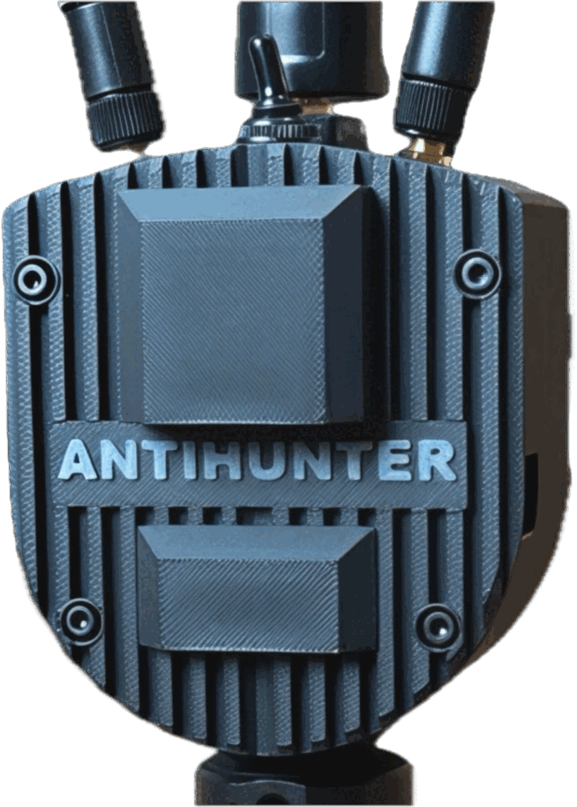
</p>

<p align="center"><i>Featured in Seeed Studio <a href="https://www.seeedstudio.com/blog/2026/01/29/best-xiao-projects/">Best 20 XIAO Projects in 2025</a>.</i></p>

> [!TIP]
> **New to AntiHunter?** [Start Here](docs/README.md) covers setup order, troubleshooting, and every guide.

---

## Table of Contents

1. [Quick start](#quick-start)
2. [What it detects](#what-it-detects)
3. [Using a node](#using-a-node)
4. [Mesh networking](#mesh-networking)
5. [Hardware](#hardware)
6. [Build & flash](#build--flash)
7. [Configuration](#configuration)
8. [Reference](#reference)
9. [Legal](#license)

---

## Quick start

The **[Operator's Guide](docs/AntiHunter-Operators-Guide.pdf)** covers each step in more detail. The **[Assembly Manual](hw/Prototype_STL_Files/Antihunter-DIGINODE-AssemblyManual.pdf)** covers building the hardware.

1. **Attach all three antennas before you power on.** See [Deployment steps by tier](#deployment-steps-by-tier).
2. **Flash the firmware.** Open the [Web Flasher](https://lukeswitz.github.io/AntiHunter/) in Chrome or Edge on a desktop. Pick **Full** or **Headless** ([which one?](#full-vs-headless)) and **Stable** or **Beta**, plug in the board, and select **Connect & Flash**. Erase when asked to clear saved settings.
3. **Connect.** Full: join the `Antihunter` Wi-Fi network (password `antihunt3r123`), open http://192.168.4.1, and log in as `admin` with the Wi-Fi password. Headless: open a serial monitor at 115200 baud.
4. **Set up the radio.** Set the LoRa region and check the serial settings. See [Radio setup](#radio-setup).
5. **Lock it down.** <a id="before-you-deploy"></a>
   - Change the access point name and password under System → Settings → **Access point**. Every unit ships with the same published defaults.
   - Set the node ID in the web UI, or with `CONFIG_NODEID` over mesh.
   - Set the radio's region and a new Bluetooth pin: `python3 scripts/meshtastic_config.py --region US --pin 481920`. In the Meshtastic app, make your own encrypted channel primary and turn off the public channel.
   - Write down the erase key the flasher shows. See [Secure data destruction](#secure-data-destruction).
   - For covert use, run Headless (no access point) and turn off the radio's screen, LED, and Bluetooth: `python3 scripts/meshtastic_config.py --screen off --led off --ble off`
   - Privacy Mode hides MACs, SSIDs, and GPS in the web UI only. Exported logs and SD files still contain them.
   - Scan only where you have authority. See the [legal disclaimer](#legal-disclaimer).
6. **Run a scan.** Pick one from [What it detects](#what-it-detects).

---

## What it detects

Every feature starts from the web UI's Scan tab, or by a text command over the mesh. **(Beta)** features exist only in the Beta firmware. **(experimental)** features may give inaccurate results.

| Feature | What it does | Mesh example | The example runs |
|---|---|---|---|
| [**Target scan**](#target-scan) | Alerts when it hears a watchlist MAC, vendor prefix, or SSID | `SCAN_START:2:300:1..11` | Wi-Fi and BLE for 300 s, channels 1-11 |
| [**Baseline anomaly**](#detection-baseline-anomaly) | Learns which devices are normally present, then reports new, gone, returning, and moved ones | `BASELINE_START:300` | Learning, then 300 s of monitoring |
| [**Device discovery**](#recon-device-discovery) | Lists nearby access points and BLE devices | `DEVICE_SCAN_START:2:300` | Wi-Fi and BLE for 300 s |
| [**Probe request scanner**](#recon-probe-request-scanner) | Lists the network names Wi-Fi devices ask for | `PROBE_START:2:300` | Wi-Fi and BLE for 300 s |
| [**Randomized MAC tracer**](#recon-randomized-mac-tracer-experimental) *(experimental)* | Groups a device's changing MACs into one identity | `RANDOMIZATION_START:2:300` | Wi-Fi and BLE for 300 s |
| [**Drone Remote ID**](#recon-drone-remote-id) | Reports drone ID, position, flight data, and operator location | `DRONE_START:300` | 300 s |
| [**Deauth detection**](#detection-deauth) | Logs deauth and disassociation frames and flags floods | `DEAUTH_START:300` | 300 s |
| [**Sentinel**](#detection-sentinel) | Detects Wi-Fi attacks in progress and names the tool when it recognizes one | `SENTINEL_ON` | Until `SENTINEL_OFF` |
| [**CSI motion**](#detection-csi-motion-beta) *(Beta)* | Detects movement from changes in the Wi-Fi signals around the node | `CSI_MOTION_START:0:FOREVER` | Until `STOP` |
| [**Packet capture**](#capture-packet-capture) | Writes Wi-Fi or BLE traffic to SD as a pcap file | `PCAP_START:0:300:0` | Wi-Fi, 300 s, 2.4 GHz |
| [**Triangulation**](#locate-triangulation-experimental) *(experimental)* | Three or more nodes with GPS estimate a device's location | `TRIANGULATE_START:AA:BB:CC:DD:EE:FF:60` | That MAC for 60 s |
| [**Tamper response**](#field-controls) | Starts a scan, or wipes the node, when someone moves it | `VIBSCAN_SET:1:2:60` | A 60 s probe scan when moved |
| [**Scheduling**](#field-controls) | Runs a scan at a set time, once or repeating | `SCHED_ADD:...` | See [Scheduled scans](#field-controls) |

### Sending a command over mesh

Send a text message from any Meshtastic radio on the node's channel. A command has up to three parts: who it is for, the command, and its values, separated by `:`.

```
@ALL DEVICE_SCAN_START:2:300
│    │                 │ └─ duration in seconds
│    │                 └─── radio: 0 Wi-Fi, 1 BLE, 2 both
│    └───────────────────── the command (or its short alias, DS)
└────────────────────────── who: @ALL for every node, @AH01 for one node
```

| Value | Meaning |
|---|---|
| Radio | `0` Wi-Fi, `1` BLE, `2` both |
| Duration | Seconds, up to 86400 (one day) |
| `FOREVER` | Add `:FOREVER` to run until you send `@ALL STOP` |

Most commands have a short alias that works in its place:

| Command | Alias | Command | Alias | Command | Alias |
|---|---|---|---|---|---|
| `SCAN_START` | `SS` | `DRONE_START` | `DR` | `PCAP_START` | `PCS` |
| `DEVICE_SCAN_START` | `DS` | `DEAUTH_START` | `DA` | `TRIANGULATE_START` | `TS` |
| `PROBE_START` | `PS` | `SENTINEL_ON` / `_OFF` | `SE1` / `SE0` | `VIBSCAN_SET` | `VSS` |
| `RANDOMIZATION_START` | `RS` | `CSI_MOTION_START` (Beta) | `CIM` | `SCHED_ADD` | `SA` |
| `BASELINE_START` | `BLS` | `STATUS` | `ST` | `STOP` | `X` |

The [mesh command reference](docs/mesh-commands.md) lists every command, value, reply, and alias.

Three settings apply to most scans:
- **Signal floor:** the node ignores devices weaker than −95 dBm. Change it with `@ALL CONFIG_RSSI:-80`. Baseline has its own setting, and triangulation and packet capture ignore it.
- **Channels:** scans that hop channels use the channel list. Set it with `@ALL CONFIG_CHANNELS:1..11` (a range) or `1,6,11` (a list). Drone detection stays on channel 6.
- **Stop:** `@ALL STOP` stops every running scan.

---

### Target scan

Keep a watchlist of MAC addresses, vendor prefixes, and SSIDs. The node alerts in the web UI and over the mesh when it hears a match.

<p align="center">
  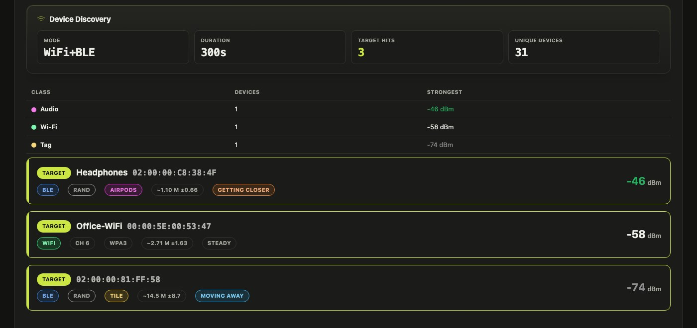
</p>

**Start:** add entries under Targets, then Scan tab → Target Scan → **Start Scan**.

**Over mesh:**
- `@ALL CONFIG_TARGETS:AA:BB:CC:DD:EE:FF|T-00A3|MyNetwork` replaces the watchlist. Separate entries with `|`. An entry is a full MAC, a vendor prefix (first three bytes), a tracer ID (`T-xxxx`), or a network name.
- `@ALL SCAN_START:2:300:1..11` scans Wi-Fi and BLE (`2`) for 300 seconds on channels 1 to 11. You must include the channel value. Put `FOREVER` in its place to run on channels 1 to 11 until `STOP`.

- The scan skips devices on the [allowlist](#field-controls).
- The node logs each hit to SD with radio, MAC, signal, channel, name, and GPS.
- Each target sends at most one mesh alert per 30 s, unless its signal changes by 5 dB or the node moves.

---

### Recon: Device discovery

Lists up to 200 nearby access points and 200 BLE devices, with MAC, SSID, signal, name, and channel.

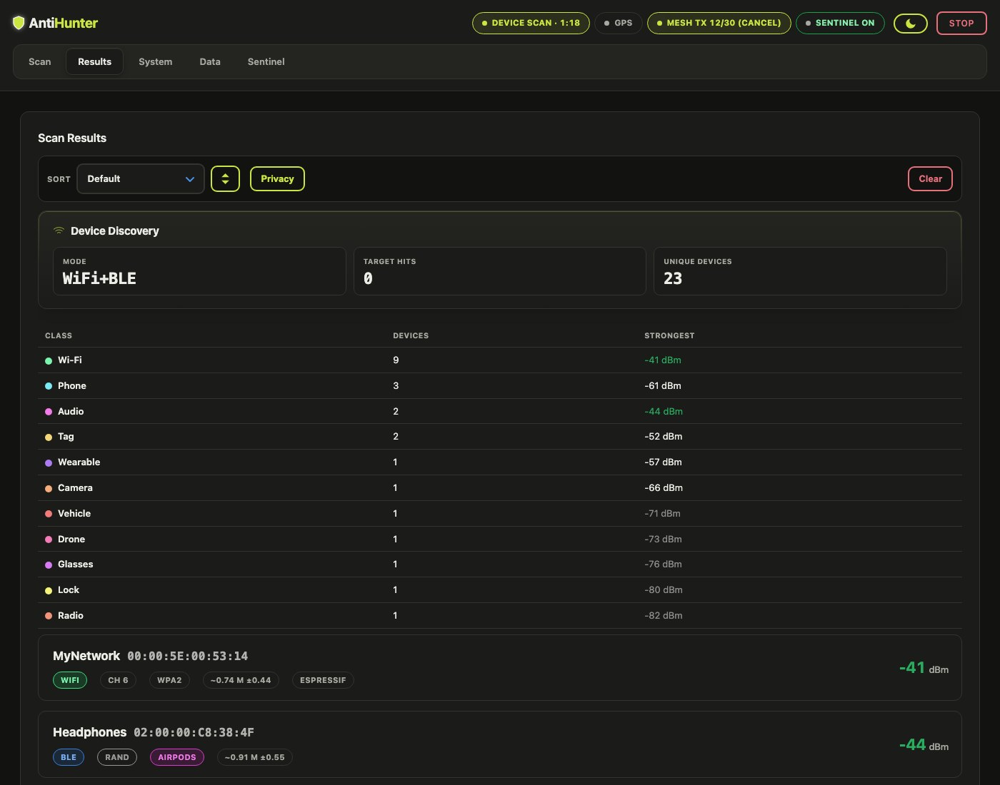

**Start:** Scan tab → Device Discovery → **Start Scan**. Tick **Capture Probes** to also collect probe requests.

**Over mesh:** `@ALL DEVICE_SCAN_START:2:300:+PROBE` scans Wi-Fi and BLE (`2`) for 300 seconds. `+PROBE` is optional and also collects probe requests.

- Several nodes can share one scan. See **Split across nodes** in [Field controls](#field-controls).
- To stop resending devices already sent over the mesh, see [Cross-scan dedup](#cross-scan-dedup).

---

### Recon: Probe request scanner

Wi-Fi devices send probe requests that name the networks they want to join. This scanner records the names each device asks for.

<p align="center">
  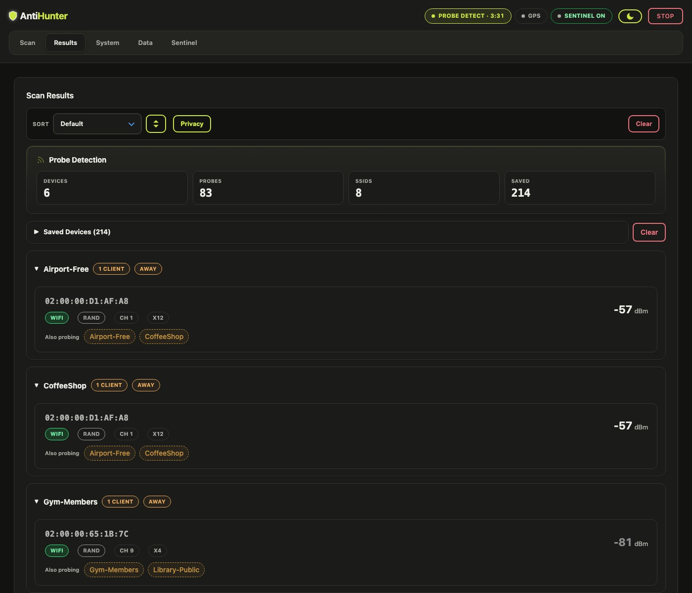
</p>

**Start:** Scan tab → Probe Request Scanner → **Start Scan**.

**Over mesh:** `@ALL PROBE_START:2:300:+ALL` listens on Wi-Fi and BLE (`2`) for 300 seconds. `+ALL` is optional. With it, the node sends every probe request it hears to the mesh. Without it, the node sends only probes from watchlist devices. `@ALL PROBE_STOP` stops the scan.

- The node keeps every probe on the node either way.
- A `~` prefix marks a name that never got a probe response.
- Vendor names come from a built-in table of 607 IEEE-registered vendors. The list flags randomized MACs.

---

### Recon: Randomized MAC tracer (experimental)

Phones change their MAC address. The tracer groups MACs that behave alike into one identity with a confidence score and an ID (`T-XXXX`), which you can use in `CONFIG_TARGETS` or `TRIANGULATE_START`.

<p align="center">
  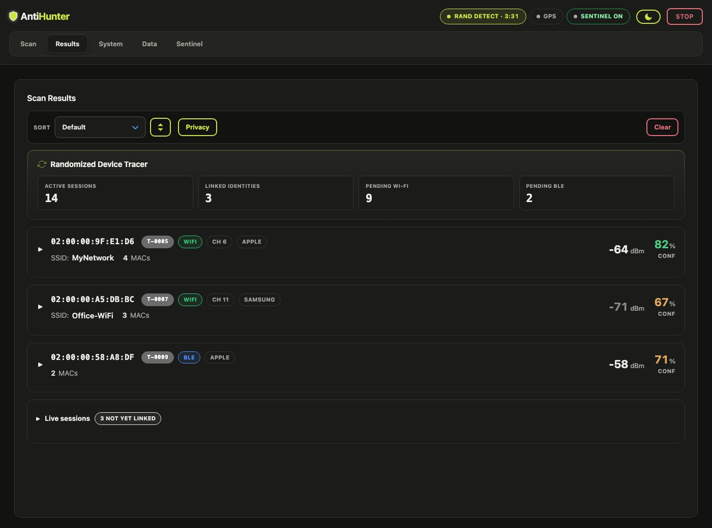
</p>

**Start:** Scan tab → Randomized MAC Tracer → **Start Scan**. Over mesh, `@ALL RANDOMIZATION_START:2:300` traces Wi-Fi and BLE (`2`) for 300 seconds.

It tracks up to 256 devices and drops the one unseen for longest.

---

### Recon: Drone Remote ID

Detects drones broadcasting Remote ID in the FAA, EASA, and French formats, and reports drone ID, operator location, and flight data to the mesh and to `/drones.jsonl` on SD.

<p align="center">
  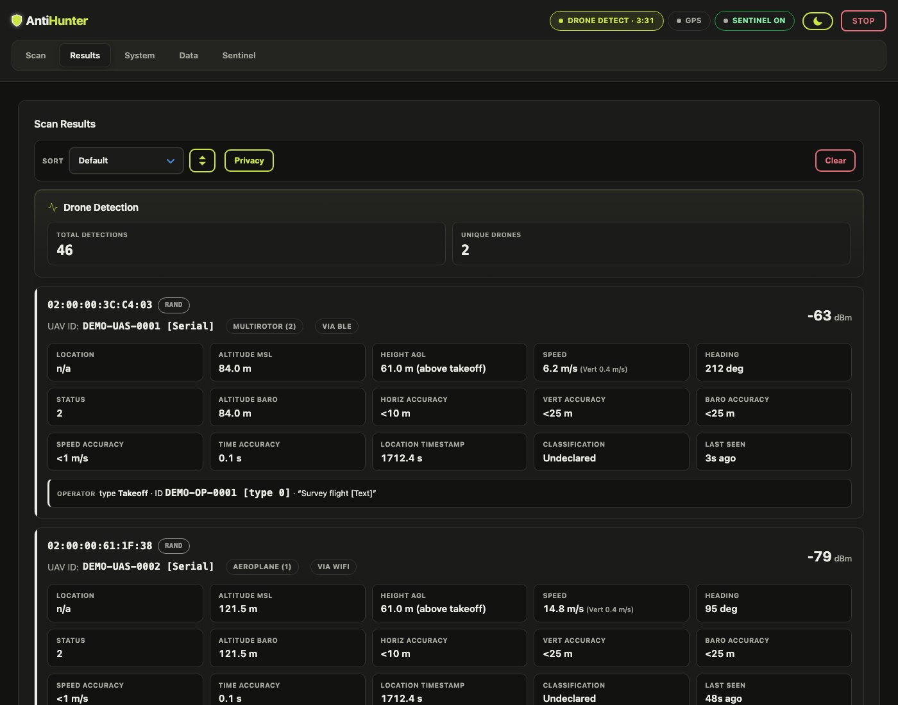
</p>

**Start:** Scan tab → Drone RID Detection → **Start Scan**. Over mesh, `@ALL DRONE_START:300` watches for 300 seconds. It takes no radio value because it always listens on both.

- The node reads Wi-Fi Remote ID on channel 6. BLE reads Bluetooth 4 broadcasts, not Bluetooth 5 long range.

---

### Detection: Baseline anomaly

Learns which access points and BLE devices are normally present, then reports devices that are new, gone, back again, or whose signal changed.

<p align="center">
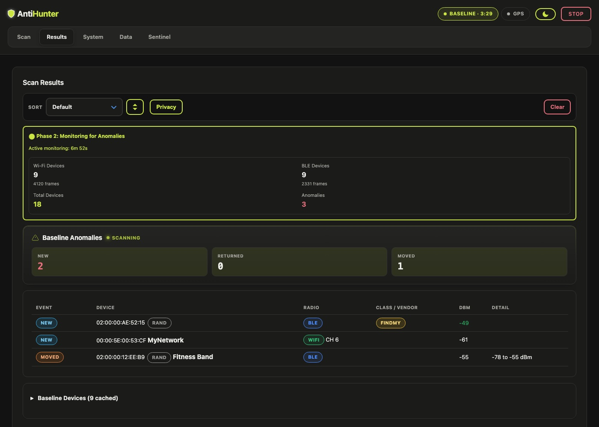
</p>

**Start:** Scan tab → Baseline Anomaly Sniffer → pick the learning time → **Start Scan**.

**Over mesh:**
- `@ALL BASELINE_START:300` learns for the time set in the web UI (5 minutes by default), then monitors for 300 seconds. The minimum is 60.
- `@ALL BASELINE_STATUS` replies with the phase, device count, and anomaly count.
- `@ALL BASELINE_WATCH` does the same as the **Compare from now** button.

**Compare from now** splits the scan into before and after the moment you press it. The button appears once learning ends.

| Result | Meaning |
|--------|---------|
| New | Heard only after you pressed it |
| Gone | Heard only before |
| Moving closer / away | Heard both times, signal changed by 20 dB or more |

With an SD card, the baseline survives a reboot.

| Setting | What it does | Default | Range |
|---|---|---|---|
| RSSI | Ignores devices weaker than this | −70 dBm | −40 to −80 |
| Baseline | Learning time | 5 min | 5, 10, 15 min |
| Marked Absent | Seconds unseen before a device counts as gone | 120 | 30-600 |
| Seen Reappear | Seconds after going missing in which a return is reported | 300 | 60-1800 |
| RSSI Variation | Signal change that counts as moving | 20 dB | 5-50 |
| RAM Cache | Devices kept in memory | 400 | 200-500 |
| SD Device Storage | Devices kept on SD | 50000 | 1000-100000 |

---

### Detection: Deauth

Watches for deauthentication and disassociation frames, which knock devices off Wi-Fi.

**Start:** Scan tab → Deauth Detection → **Start Scan**. Over mesh, `@ALL DEAUTH_START:300` watches for 300 seconds.

- It alerts on any broadcast deauth, and on 10 deauths to one client within 10 s.
- It flags `DEAUTH_FLOOD` at 20 deauths from one source within 10 s.
- An attacker can fake the source address shown in the alert.

---

### Detection: Sentinel

Sentinel listens for Wi-Fi attacks in the background and pauses while another scan runs. It detects deauth floods, beacon spam, evil twin access points, PMKID requests, forced WPA handshakes, and more. It names the tool when it recognizes one: Marauder, MDK4, ESP Deauther, aireplay-ng, bettercap, hcxdumptool, Bruce, or Pwnagotchi.

<p align="center">
  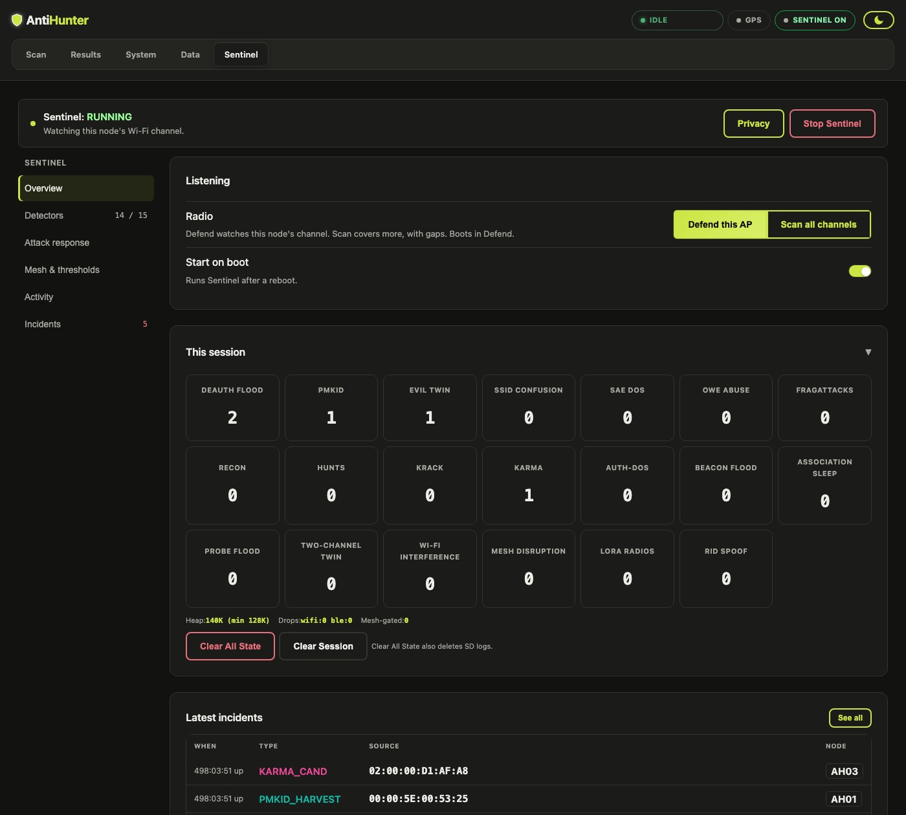
</p>

**Start:** Sentinel tab → **Start Sentinel**.

**Over mesh:**

| Command | What it does |
|---|---|
| `@ALL SENTINEL_ON` / `SENTINEL_OFF` | Starts or stops Sentinel |
| `@ALL SENTINEL_BOOT:1` | Starts Sentinel at every power-on. `0` turns this off |
| `@ALL SENTINEL_MODE:scan` | Hops across channels. `defend` stays on the node's own access point channel. Headless has no access point, so use `scan` |
| `@ALL GROUP:dos:on` | Turns one detector group on or off. Groups: `dos`, `rogue`, `recon`, `physical`, `mesh`, or `all` |

- After a confirmed attack, Sentinel can triangulate, capture packets, or run a scan. These are off by default. Turn them on under Sentinel tab → **Attack response** → **On confirmed attack**.
- Karma bait is the only detector that transmits: one probe request every 8 s while on. It is off by default.
- Detections go to serial, SD, and `/incidents.jsonl`, and to the mesh if that detector's broadcast is on.
- Each detection records what triggered it, such as the source MACs, network names, counts, signal, and channel. Serial prints it on a `[DETECT] ... evidence` line, and the SD logs and `/incidents.jsonl` store it in the `ev` field. Mesh alerts carry only the short alert line, so a peer's evidence stays on that peer's SD card.

<details>
<summary>Detector groups and test coverage</summary>

| Group | Detectors |
|---|---|
| **DoS** | Deauth flood, deauth forge, broadcast deauth, AP-targeted deauth, beacon flood, auth flood, assoc-sleep, SAE DoS |
| **Rogue AP** | Evil twin, OWE abuse, Karma / MANA |
| **Recon** | PMKID harvest, probe flood, forced handshake |
| **Physical** | FragAttacks, two-channel twin, Wi-Fi interference |
| **Mesh disruption** | Self-spoof, channel flood, command audit |

- **Confirmed on hardware:** deauth flood, deauth forge, AP-targeted deauth, beacon flood, auth flood, assoc-sleep, SAE DoS, karma, evil twin, probe flood, forced handshake.
- **Experimental:** OWE abuse, PMKID harvest, FragAttacks, two-channel twin, Wi-Fi interference, mesh disruption.
- **Tested against:** airgeddon, aireplay-ng, bettercap, wifite, mdk4, angryoxide, eaphammer, hostapd-mana, wifipumpkin3, hcxdumptool, and common ESP32 attack firmware.
- Detectors that check crypto and beacons skip phone hotspots. Flood detectors do not.

The [mesh command reference](docs/mesh-commands.md#sentinel) lists every Sentinel command and alert label.

</details>

---

### Detection: CSI motion (Beta)

Alerts when something moves nearby, including through walls. It works indoors and needs ongoing Wi-Fi traffic. It detects movement, not presence.

<p align="center">
  
</p>

**How it works.** Wi-Fi signals bounce around a room, and a moving person changes the bounces. The node listens to nearby routers, and phones if you include randomized MACs, and alerts when their signals change together.

**Start:** Scan tab → CSI Motion Detection → **Start Scan**. Over mesh, `@ALL CSI_MOTION_START:0:FOREVER` runs until `@ALL STOP`. Replace `0:FOREVER` with a number of seconds for a timed run.

| Sensitivity | Behavior |
|---|---|
| **Low** (default) | Fewest false alarms. Two devices must see the movement |
| **Medium** | Two devices, or one device seeing 4× the trigger |
| **High** | Lower trigger and shorter wait. Expect false alarms |

If it alerts in an empty room, turn on **Per-packet score to serial**, note the highest `sig` value with the room empty, and set **Trigger level** slightly above it. The other settings are under **Advanced**.

> [!WARNING]
> If you turn off **Listen only, never transmit**, the node sends Wi-Fi probe requests when it hears too little traffic. Anyone nearby can see them.

---

### Capture: Packet capture

Records traffic to SD as a pcap file that Wireshark opens.

<p align="center">
  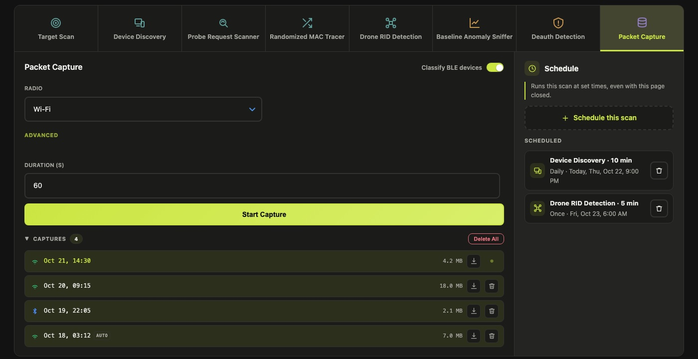
</p>

**Start:** Scan tab → Packet Capture → **Start Capture**. Over mesh, `@ALL PCAP_START:0:300:0:CH1,6,11` captures Wi-Fi for 300 s on channels 1, 6, and 11. Stop with `@ALL PCAP_STOP`.

| Field | Values |
|---|---|
| Radio | `0` Wi-Fi, `1` BLE |
| Duration | Seconds, required |
| Band | `0` 2.4 GHz, `1` 5 GHz, `2` both. 5 GHz on C5 only |
| Channels | Optional `:CH` list |

- Wi-Fi frames carry channel and signal strength. BLE captures have no channel.
- The Scan tab lists captures to download or delete.
- The node deletes old Sentinel captures to stay under a size budget. It never deletes captures you start.

> [!WARNING]
> Stop a capture before cutting power, or you may lose the end of the file.

---

### Locate: Triangulation (experimental)

Several nodes listen for the same device and record its signal strength and their own GPS position. With three or more nodes that have a GPS fix, the mesh estimates the device's location.

**Start over mesh:** `@AH01 TRIANGULATE_START:AA:BB:CC:DD:EE:FF:60:2`. Send it to one node, here AH01, and that node runs it with every other node on the mesh.

| Value | Meaning |
|---|---|
| `AA:BB:CC:DD:EE:FF` | The device to locate: a MAC, or a tracer ID (`T-xxxx`) |
| `60` | How long to listen, in seconds |
| `2` | Optional. The environment from the table below. Default `2`, Indoor |

Get the result with `@AH01 TRIANGULATE_RESULTS`, and stop early with `@ALL TRIANGULATE_STOP`. The result has coordinates, confidence, estimated error in meters, and a Google Maps link. It ignores readings of −95 dBm or weaker.

<details>
<summary>RF environment calibration</summary>

The node turns signal strength into distance with `distance = 10^((RSSI0 - RSSI) / (10 * n))`.

| Value | Environment | Wi-Fi n | BLE n | Wi-Fi RSSI0 | BLE RSSI0 | Use case |
|---|-------------|--------|-------|------------|-----------|----------|
| `0` | Open Sky | 2.0 | 2.0 | -23 dBm | -60 dBm | Clear line of sight |
| `1` | Suburban | 2.7 | 2.5 | -24 dBm | -62 dBm | Light foliage, scattered buildings |
| `2` | Indoor | 3.2 | 2.9 | -25 dBm | -65 dBm | Typical indoor, some walls |
| `3` | Indoor Dense | 4.0 | 3.5 | -27 dBm | -69 dBm | Offices, many partitions |
| `4` | Industrial | 4.8 | 4.0 | -30 dBm | -73 dBm | Heavy obstruction, machinery |

Two more optional values after the environment scale the Wi-Fi and BLE distance estimates, from 0.1 to 5.0 (default 1.0): `TRIANGULATE_START:AA:BB:CC:DD:EE:FF:60:2:1.0:1.0`.

To measure RSSI0 instead of using the table, calibrate each node. Place a Wi-Fi access point or BLE device a measured distance from the node, then send `@AH01 CALIBRATE:AA:BB:CC:DD:EE:FF:5` (5 m), or use System tab → **Settings** → **Scanning** → **Distance calibration**. The node listens for 30 seconds and keeps the result after a reboot. Send `@AH01 CALIBRATE_RESET` when you move the node. The [mesh command reference](docs/mesh-commands.md#distance-calibration) lists the replies.

</details>

---

## Using a node

### Full vs Headless

Both builds run the same detectors. Full adds a Wi-Fi access point with the web UI and [API](docs/api-reference.md). Headless has no access point.

| | Full | Headless |
|---|---|---|
| Control | Web UI, API, serial, mesh | Serial, mesh |
| Results | Results tab and `/last_results.txt` on SD | `/last_results.txt` on SD |
| Device database | `/devicedb.jsonl` | `/devicedb.jsonl` |
| Scheduling | Scan tab and `SCHED_ADD` | `SCHED_ADD`, once the clock is set |
| Fleet roster | System tab → **Fleet** | Not tracked |
| Radio footprint | Access point beacons, unless hidden | No access point |

### Web UI

The web UI has five tabs: **Scan**, **Results**, **System**, **Data**, and **Sentinel**. On the Scan tab, pick a scan, the radio, and a duration, then select **Start Scan**.

<p align="center">
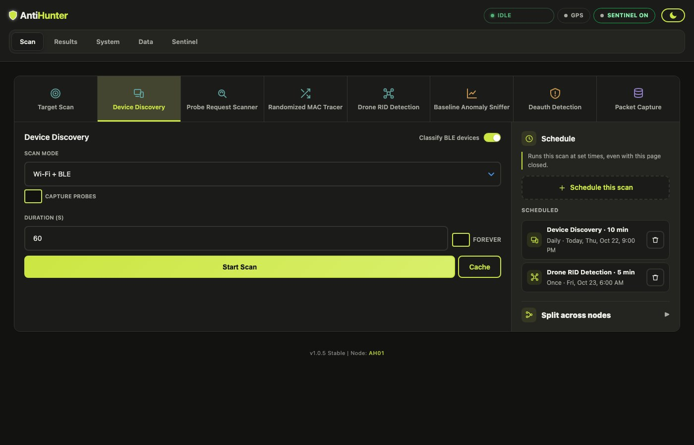
</p>

The **System** tab has a menu on the left, or a row of tabs on a phone. It opens **Diagnostics**, **Fleet**, or one of the **Settings** sections. The **Data** tab shows findings, device logs, and scan data.

<details>
<summary>System tab contents</summary>

<p align="center">
  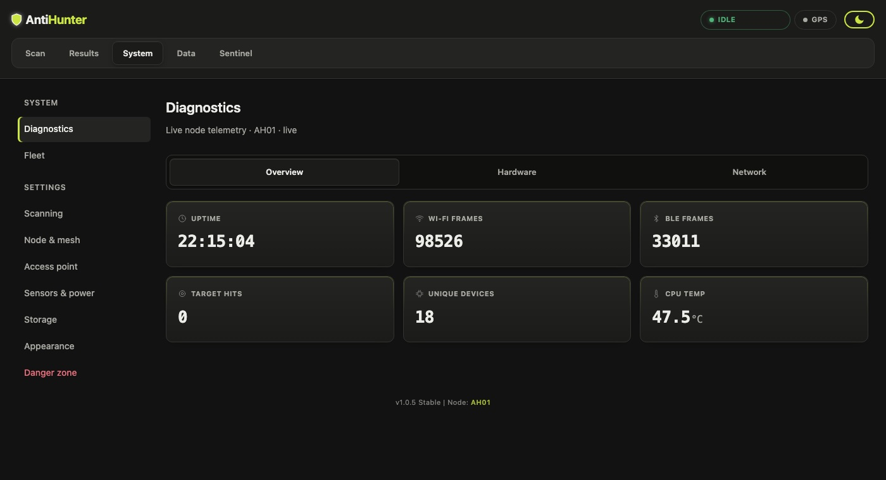
</p>

| Section | What it holds |
|---|---|
| **Diagnostics** | Uptime, frame counts, hits, temperature, memory, SD, GPS, clock, vibration sensor, and network state |
| **Fleet** | Nodes and radios heard on the mesh, with mode, uptime, hits, and GPS |
| Settings → **Scanning** | Signal filter, RF environment, scan profile, channel time and list, BLE timing |
| Settings → **Node & mesh** | Node ID, mesh on/off, heartbeat, alert interval, repeat filters |
| Settings → **Access point** | Network name, password, security, hidden network, web login |
| Settings → **Sensors & power** | Vibration alert and scan, Battery Saver |
| Settings → **Storage** | SD status and repair |
| Settings → **Appearance** | Theme and accent colors, stored in the browser |
| Settings → **Danger zone** | Erase key, Wipe now, auto-erase on tamper, factory reset |

<p align="center">
  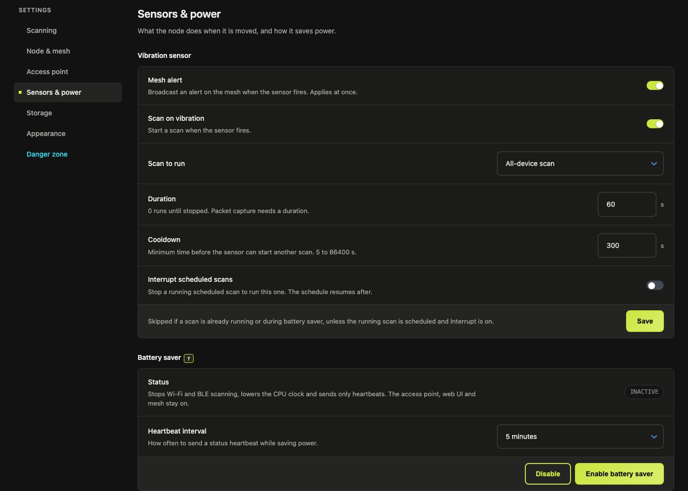
</p>

<p align="center">
  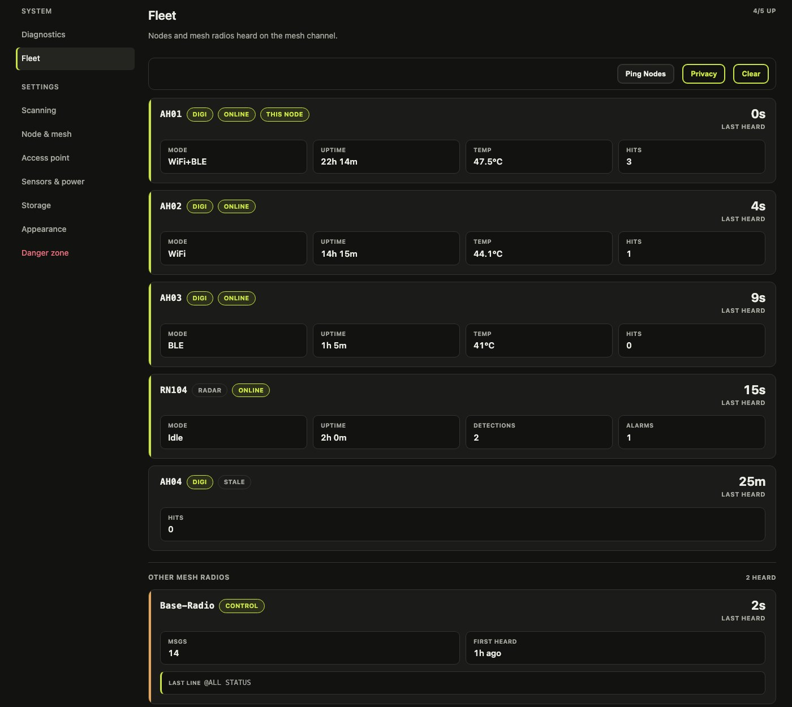
</p>

</details>

### Field controls

| Control | What it does | Where |
|---|---|---|
| **Allowlist** | Devices that Target Scan and Baseline ignore | Scan tab → **Allow list** |
| **Privacy Mode** | Masks MACs, SSIDs, and GPS in the web UI for screenshots | **Privacy** button |
| **Vibration trigger** | Starts a scan when the node is moved | System → Settings → **Sensors & power**, or `VIBSCAN_SET` |
| **Scheduled scans** | Runs a scan at a set time, once or repeating, up to 8 entries | Scan tab → **Schedule this scan**, or `SCHED_ADD` |
| **Split across nodes** | Runs one device scan across the checked nodes. By radio, nodes alternate Wi-Fi and BLE. By channel, each node sweeps its share of the channel list | Scan tab → Device Discovery → **Split across nodes** |
| **Campaigns** | Tags all SD logs with a name between start and stop, for export as one set | Data tab, or `CAMPAIGN_START:site-a` to start a campaign named `site-a` and `CAMPAIGN_STOP` to end it |
| **BLE classifier** | Labels BLE devices by type, such as `AirPods` or `Tile`. On by default | Scan tab → **Classify BLE devices**, or `BLE_CLASSIFY:0` to turn it off and `BLE_CLASSIFY:1` to turn it on |
| **Battery Saver** | Stops scanning and lowers the CPU clock. The mesh stays on and sends a heartbeat | System → Settings → **Sensors & power**, or `BATTERY_SAVER_START:10` for a heartbeat every 10 minutes (1-30) and `BATTERY_SAVER_STOP` to end it |
| **Hidden network** | Stops the access point broadcasting its name. It does not keep anyone out | System → Settings → **Access point** |
| **SD repair** | Rebuilds an SD card the node can't mount. This erases the card. Off by default | System → Settings → **Storage**, or `SD_REPAIR:ON` to allow it, `OFF` to forbid it, `NOW` to remount now |

**Vibration trigger over mesh:** `@AH01 VIBSCAN_SET:1:2:60:300`

| Value | Meaning |
|------|-------|
| `1` | `1` turns it on, `0` turns it off |
| `2` | The scan to run: `1` device discovery, `2` probe, `3` randomized MAC tracer, `4` target, `5` drone, `6` deauth, `7` baseline, `8` packet capture |
| `60` | Scan length in seconds. `0` runs until `STOP`, except packet capture, which needs a length |
| `300` | Optional. Seconds before the sensor can trigger again, 5 to 86400 |
| (fifth value) | Optional. `1` lets it interrupt a running scheduled scan, which resumes after. Default `0` |

**Scheduled scans over mesh:** `@AH01 SCHED_ADD:2026-10-07T21:00|86400|/scan|mode=2&secs=600` runs a 10-minute Wi-Fi and BLE target scan every day at 21:00. A `|` separates the four values:

| Value | Meaning |
|------|-------|
| `2026-10-07T21:00` | First start, in the node's local time |
| `86400` | Seconds between runs. `0` runs once. The minimum is 600 |
| `/scan` | The scan: `/scan` target scan, `/sniffer` device discovery, `/drone` drone detection |
| `mode=2&secs=600` | `secs` is the run length. `mode` (`0` Wi-Fi, `1` BLE, `2` both) applies to `/scan` |

`@AH01 SCHED_LIST` lists the entries on serial, and `@AH01 SCHED_DEL:1` deletes entry 1. Headless runs scheduled scans once it has the time, from GPS or from `SETTIME:<unix seconds>` on USB serial.

### Secure data destruction

The node can erase its settings and SD files on command, or when someone moves it while auto-erase is on. It needs an SD card. A wipe can't be undone.

**Erase key.** Every wipe needs it. The node makes one on first start, and every way of flashing shows it: Web Flasher step 2, the flash script, and `pio run -t upload`. **Write it down.**

| When you flash with | The erase key |
|---|---|
| **Erase device** off | Is kept. A key the node made is shown again. |
| **Erase device** on (script `-e`, source `pio run -t erase`) | Is replaced. The node makes and shows a new one. |

**Lost the key?** Flash with **Erase device** on. Settings come back from the SD card. The AP password and web password go back to their defaults.

**Change the key:** System → Settings → **Danger zone**, or `CONFIG_ERASE_PSK:<new>:<current>`.

**Wipe**
- Web UI: enter the key under **Erase key**, press **Wipe now**.
- Mesh: send `@AH01 ERASE_REQUEST`. Paste the token and your key into **Erase Answer** on the [Web Flasher page](https://lukeswitz.github.io/AntiHunter/). Send `@AH01 ERASE_FORCE:<answer>` within 5 minutes. Your key never goes over the radio.

**Auto-erase on tamper** is off by default. Once armed, a set number of vibrations starts a countdown and sends `TAMPER_DETECTED`. Turn it on under System → Settings → **Danger zone** → **Auto-erase**. Five wrong keys lock erase commands for 10 minutes.

The [mesh command reference](docs/mesh-commands.md#erase) lists every erase command, reply, and setting.

---

## Mesh networking

The mesh is optional. A node works fully on its own. With a mesh, you control nodes by sending text messages from any Meshtastic app on the node's channel.

- `@ALL COMMAND` goes to every node and `@AH01 COMMAND` to one. Node IDs are 2-5 letters or digits.
- Replies and alerts come back on the same channel.
- Keep the radio's short name different from the node ID. The node ignores its own ID as an echo.

The [mesh command reference](docs/mesh-commands.md) lists every command and alert.

### Radio setup

The radio needs the **Serial** module on, mode **TEXTMSG**, baud **115200**, and your board's pins: `19 RX / 20 TX` on Heltec V3, `10 RX / 9 TX` on T114. It also needs a LoRa region. With no region it receives but never transmits.

Soldered Core and Assembled radios ship with serial already set. The region ships unset and the channel is the public default.

Set it up one of three ways:
- **Phone:** pair the radio in the [Meshtastic app](https://meshtastic.org/docs/software/), then set Module Settings → Serial and LoRa → Region.
- **Browser:** use the [Meshtastic web client](https://meshtastic.org/docs/software/) over USB in Chrome or Edge.
- **Script:** plug the radio in on its own USB and run:

```bash
pip3 install 'meshtastic[cli]' pyserial
python3 scripts/meshtastic_config.py                     # show settings and a menu
python3 scripts/meshtastic_config.py --serial on --region US
python3 scripts/meshtastic_config.py --board t114 --serial on
```

Run the script with `--help` for every option.

### Other Meshtastic clients

Commands and alerts are ordinary Meshtastic text messages, so any client works:
- **Meshtastic app** over Bluetooth, Wi-Fi, or USB. [Quick chat](https://meshtastic.org/docs/software/android/user/messages-and-channels/) puts common commands on buttons.
- **ATAK** with the [Meshtastic ATAK plugin](https://meshtastic.org/docs/software/integrations/integrations-atak-plugin/). Set the radio's role to `TAK`.
- **MQTT** through a Meshtastic [MQTT gateway](https://meshtastic.org/docs/software/integrations/mqtt/).

### Reaching a node you cannot hear

Nodes between you and a distant node relay your messages, [3 hops by default and 7 at most](https://meshtastic.org/docs/configuration/radio/lora/). A standalone radio in the `ROUTER` or `REPEATER` [role](https://meshtastic.org/docs/configuration/radio/device/) extends range further.

### Cross-scan dedup

To save airtime, the node does not resend a device it sent over the mesh within the last 5 minutes. Change the time, from 0 to 3600 seconds, with `@ALL CONFIG_DEDUP_TTL:<seconds>` or under System → Settings → **Node & mesh** → **Repeat filter**. `0` turns the filter off. The filter applies only to device lists. Alerts are always sent.

---

## Hardware

Buy a node from the [store](https://lectronz.com/stores/antihunter), or build one from the parts below.


> [!IMPORTANT]
> Use a regulated 5 V supply. Unregulated batteries cause voltage instability.

### Deployment steps by tier

No tier ships with AntiHunter installed. Flash it yourself ([Quick start](#quick-start), step 2).

| Tier | What ships | What you supply |
|---|---|---|
| **Bare PCB** ([note](docs/note-tier4-bare-pcb.pdf)) | One unpopulated board | All parts ([BOM](hw/Prototype_STL_Files/BOM-Links.md)), soldering, Meshtastic setup, a FAT32 SD card |
| **Soldered Core PCB** ([note](docs/note-tier3-populated-pcb.pdf)) | Populated board with ESP32-S3, Heltec radio, GPS, clock, vibration sensor, SD reader, 8 GB card, radio configured. U.FL whip antennas | Optional enclosure, 5 V power, external antennas |
| **Parts Kit** ([note](docs/note-tier2-parts-kit.pdf)) | Every BOM part, loose, except the active GPS antenna and 18650 cells | Assembly, Meshtastic setup, two 18650 cells, GPS antenna |
| **Assembled** ([note](docs/note-tier1-assembled.pdf)) | Built, sealed, and tested, with an 8 GB card, GPS antenna, and configured radio | Two 18650 cells |

### Core components

- **Seeed XIAO ESP32-S3** (8 MB flash or more), or **XIAO ESP32-C5** for 2.4 and 5 GHz ([C5 page](docs/ESP32-C5.md), testing)
- **Meshtastic board:** Heltec V3.2 (recommended) or T114
- **GPS, SD card, vibration sensor, and real-time clock**

The [assembly manual](hw/Prototype_STL_Files/Antihunter-DIGINODE-AssemblyManual.pdf), [bill of materials](hw/Prototype_STL_Files/BOM-Links.md), [welcome letter](hw/Prototype_STL_Files/ahwelcome.txt), and enclosure [STL files](hw/Prototype_STL_Files) cover the build.

<details>
<summary>Pinout (XIAO ESP32-S3)</summary>

Check these against your board revision.

| Function | GPIO |
|----------|------|
| Vibration sensor (SW-420) | 2 |
| Clock SDA (DS3231) | 3 |
| Clock SCL (DS3231) | 6 |
| GPS RX | 44 |
| GPS TX (unused) | 43 |
| SD CS | 1 |
| SD SCK | 7 |
| SD MISO | 8 |
| SD MOSI | 9 |
| Mesh RX | 4 |
| Mesh TX | 5 |

</details>

### Node types

All three use the same PCB and mesh.

| | Board | Sensor | Status |
|---|---|---|---|
| **DIGI** | ESP32-S3 | Wi-Fi and BLE, 2.4 GHz | Stable |
| **[DIGI C5](docs/ESP32-C5.md)** | ESP32-C5 | Wi-Fi and BLE, 2.4 and 5 GHz | Testing |
| **[RadarNode](docs/RADARNODE.md)** | ESP32-C5 | 24 GHz radar, then a Wi-Fi and BLE sweep | Experimental |

<p align="center">
  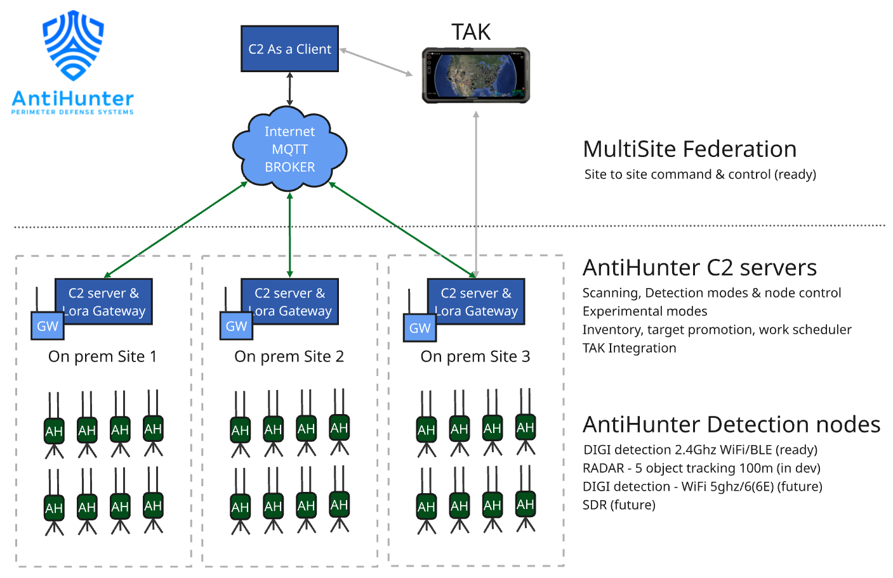
</p>

---

## Build & flash

To flash without the [Web Flasher](https://lukeswitz.github.io/AntiHunter/), use the script or build from source.

### CLI flash

```bash
curl -fsSL -o flashAntihunter.sh https://raw.githubusercontent.com/lukeswitz/AntiHunter/main/Dist/flashAntihunter.sh
chmod +x flashAntihunter.sh
./flashAntihunter.sh        # -e erases first, -c sets device parameters, -l lists firmware
```

The script asks you to pick Stable, Beta, or Experimental, and then a firmware.

### Build from source

You need PlatformIO, Git, and a USB cable.

```bash
git clone https://github.com/lukeswitz/AntiHunter.git
cd AntiHunter
pio run -e AntiHunter-full -t upload        # Full: web UI on its own access point
pio run -e AntiHunter-headless -t upload    # Headless: serial and mesh only
pio device monitor -e AntiHunter-full       # serial output
pio run -e AntiHunter-full -t erase         # blank the chip, then upload again
```

The first build downloads the toolchain into `.pio/core` (about 6 GB) and takes a few minutes. The ESP32-C5 builds are on the `feat/c5` branch ([C5 page](docs/ESP32-C5.md)).

---

## Configuration

### RF scan presets

Set under System → Settings → **Scanning**. A preset sets scan timing and the signal floor, and resets the channel list to 1-11.

| Preset | Wi-Fi channel time | Wi-Fi scan interval | BLE scan interval | BLE scan duration | Signal floor |
|--------|----------------|---------------|--------------|--------------|----------------|
| Relaxed | 300 ms | 5000 ms | 6000 ms | 3000 ms | −80 dBm |
| Balanced (default) | 160 ms | 3000 ms | 4000 ms | 2000 ms | −95 dBm |
| Aggressive | 110 ms | 1500 ms | 2000 ms | 1000 ms | −100 dBm |
| Custom | You set each value | | | | |

Channel time is how long the node listens on each channel. The scan interval is how often it runs a full access point scan. Channels take a list (`1,6,11`) or a range (`1..14`).

---

## Reference

- [Start Here](docs/README.md): setup order, troubleshooting, and every guide
- [Operator's Guide](docs/AntiHunter-Operators-Guide.pdf): unboxing to deployment, with a printable quick-reference card
- [Mesh commands](docs/mesh-commands.md): every command, parameter, and alert
- [API reference](docs/api-reference.md): the Full firmware's HTTP endpoints

## Contributing

Ask questions and share builds in [Discussions](https://github.com/lukeswitz/AntiHunter/discussions) or on [Discord](https://discord.gg/AYFzUurfmh). Report bugs in [Issues](https://github.com/lukeswitz/AntiHunter/issues). Pull requests are welcome.

## Acknowledgments

Original concept and hardware design by @TheRealSirHaXalot.

This project includes code from [opendroneid-core-c](https://github.com/opendroneid/opendroneid-core-c), licensed under the Apache License 2.0. Copyright © Intel Corporation and OpenDroneID contributors

## License

Firmware: [GNU Affero General Public License v3.0](LICENSE). Hardware and documentation: as stated in their files.

## Legal disclaimer

<details>
<summary>Full Disclaimer</summary>

```
# Legal Disclaimer

AntiHunter ("AH", the "Project") comprises open-source firmware, source code, hardware designs, and associated documentation distributed for lawful, authorized defensive use only. You may operate the Project solely on infrastructure, networks, devices, radio spectrum, and datasets that you own or for which you hold explicit, written permission to assess. By downloading, compiling, flashing, assembling, energizing, or otherwise using the Project you agree to the following conditions:

- **Authorization & intent.** Use is limited to security research, blue-team training, regulatory-compliant monitoring, event security, network auditing, and other defensive activities. Offensive operations, targeted surveillance, stalking, harassment, or tracking of individuals without their informed consent are strictly prohibited. Detection, correlation, and triangulation capabilities are provided to characterize an environment you are authorized to assess, not to identify or follow persons.

- **Radio & telecommunications compliance.** You are responsible for abiding by every jurisdictional regulation governing radio frequency use, including FCC Part 15 and Part 97, CE/RED, Ofcom, and equivalent national rules; LoRa/ISM band allocations, power limits, and duty-cycle restrictions; and any licensing conditions applicable to your operating class. LoRa firmware is region-locked (868 MHz EU / 915 MHz US / 923 MHz Asia); operating a build outside its intended regulatory region may be unlawful. You must not use the Project to cause harmful interference or to interfere with authorized radio communications.

- **Interception & wiretap law.** Passive reception of radio emissions is regulated separately from network access in many jurisdictions. Depending on your location and the mode in use, capturing, storing, decoding, or disclosing frame contents, payloads, or identifiers may implicate the U.S. Wiretap Act (18 U.S.C. § 2511), the Electronic Communications Privacy Act, state two-party-consent statutes, the UK Investigatory Powers Act, or equivalent law. Determine the lawfulness of each capture mode in your jurisdiction before enabling it.

- **Privacy & data protection.** MAC addresses, device identifiers, probe request contents, BLE advertisements, and Remote ID broadcasts may constitute personal data under GDPR, UK GDPR, CCPA/CPRA, ePrivacy, and similar regimes. Collect telemetry only with a lawful basis. Obtain consent where required, minimize collection, apply retention and destruction schedules that match applicable law, and honor data-subject rights. The maintainers do not process, receive, or host your data.

- **Drone Remote ID.** Reception of broadcast Remote ID is permitted in most jurisdictions, but using Remote ID data to locate, approach, confront, or interfere with an aircraft or its operator may violate aviation, harassment, or anti-stalking law, including 18 U.S.C. § 32. Remote ID reception is not an authorization to act on what you receive.

- **Computer misuse laws.** Scanning, probing, or accessing third-party networks without permission may violate the Computer Fraud and Abuse Act, the UK Computer Misuse Act, EU Directive 2013/40, or similar statutes. Always obtain written authorization before interfacing with systems you do not control.

- **Export & sanctions.** You must ensure distribution and use complies with the U.S. EAR (including controls applicable to cryptographic and telemetry functionality), EU dual-use regulations, applicable sanctions regimes, and any contractual restrictions. The maintainers make no export classification representations and grant no export approvals.

- **Hardware, assembly & safety.** Kits, bare PCBs, and assembled units are supplied for use by persons competent in electronics assembly and operation. You are responsible for correct assembly, soldering, ESD control, antenna selection and attachment, and supply of regulated 5 V power. Operating the transceiver without a properly matched antenna may damage the hardware. Lithium cells are not supplied; sourcing, protection circuitry, charging, storage, transport, and disposal of any battery are your responsibility and carry fire and injury risk. The hardware is not certified for, and must not be used in, life-safety, medical, aviation, automotive, industrial-control, or other applications where failure could result in death, injury, or environmental damage. It is not a substitute for a certified security, alarm, or life-safety system, and detection results are advisory only, subject to false positives and false negatives.

- **Units, kits, and builds supplied by the maintainers.** These terms apply in full to units the maintainers assembled, kits and bare boards they shipped, firmware flashed with tools they published, and builds produced by following their documentation, BOM, wiring diagrams, or flashing instructions. Assembly, sale, or instruction by the maintainers creates no warranty, no certification, no fitness-for-purpose representation, and no assumption of responsibility for how a unit is later configured, deployed, or used. Once the unit is in your hands, operation and compliance are yours alone. Flashing the firmware - by the web flasher, the shell script, or any other means - is acceptance of these terms.

- **Experimental features.** Modes designated beta or experimental - including Sentinel, Triangulation, and MAC Randomization Correlation - are unvalidated, may produce inaccurate or misleading output, and must not be relied upon for operational, evidentiary, investigative, or safety decisions.

- **Operational safeguards.** Run the Project on hardened, access-controlled infrastructure. You are responsible for segregation of duties, credential management, network isolation of nodes and mesh links, and preventing unauthorized access to captured telemetry or command functions.

- **Forks and modifications.** The firmware is licensed under the GNU Affero General Public License v3.0; hardware and documentation are licensed as stated in their respective files. If you fork, redistribute, modify, manufacture, or resell the Project, you are solely responsible for supporting your derivative work, for its regulatory compliance and certification, and for any representations you make about it. The original authors and contributors are not liable for defects or legal issues introduced by third-party changes, packaging, integrations, or manufacture.

## No Warranty / Limitation of Liability

THE PROJECT - INCLUDING SOFTWARE, FIRMWARE, HARDWARE DESIGNS, AND DOCUMENTATION - IS PROVIDED "AS IS" AND "AS AVAILABLE," WITHOUT WARRANTY OF ANY KIND, EXPRESS OR IMPLIED, INCLUDING BUT NOT LIMITED TO WARRANTIES OF MERCHANTABILITY, FITNESS FOR A PARTICULAR PURPOSE, TITLE, NON-INFRINGEMENT, ACCURACY, DETECTION EFFICACY, OR UNINTERRUPTED OPERATION. THIS DISCLAIMER SUPPLEMENTS AND DOES NOT LIMIT THE WARRANTY DISCLAIMER AND LIABILITY LIMITATION SET OUT IN SECTIONS 15 THROUGH 17 OF THE GNU AFFERO GENERAL PUBLIC LICENSE V3.0.

TO THE MAXIMUM EXTENT PERMITTED BY LAW, THE AUTHORS, DEVELOPERS, MAINTAINERS, AND CONTRIBUTORS SHALL NOT BE LIABLE FOR ANY DIRECT, INDIRECT, INCIDENTAL, SPECIAL, EXEMPLARY, PUNITIVE, OR CONSEQUENTIAL DAMAGES (INCLUDING, WITHOUT LIMITATION, LOSS OF DATA, PROFITS, GOODWILL, EQUIPMENT, OR BUSINESS INTERRUPTION, OR DAMAGES ARISING FROM FAILURE TO DETECT, FALSE DETECTION, OR REGULATORY ENFORCEMENT ACTION) ARISING FROM OR RELATED TO YOUR USE OF THE PROJECT, EVEN IF ADVISED OF THE POSSIBILITY OF SUCH DAMAGES. WHERE LIABILITY CANNOT BE FULLY DISCLAIMED, TOTAL AGGREGATE LIABILITY SHALL NOT EXCEED THE GREATER OF (A) THE AMOUNT PAID, IF ANY, FOR THE COPY OR UNIT THAT GAVE RISE TO THE CLAIM OR (B) USD $0.

NOTHING IN THIS DISCLAIMER EXCLUDES OR LIMITS LIABILITY THAT CANNOT LAWFULLY BE EXCLUDED OR LIMITED, INCLUDING LIABILITY FOR DEATH OR PERSONAL INJURY CAUSED BY NEGLIGENCE, FOR FRAUD, OR ANY NON-EXCLUDABLE STATUTORY CONSUMER RIGHTS. SOME JURISDICTIONS DO NOT ALLOW THE EXCLUSION OF IMPLIED WARRANTIES OR THE LIMITATION OF INCIDENTAL OR CONSEQUENTIAL DAMAGES, SO SOME OF THE ABOVE MAY NOT APPLY TO YOU.

## Responsibility for Compliance

You alone are responsible for ensuring your build, deployment, and operation comply with all applicable laws, regulations, licenses, permits, equipment authorizations, organizational policies, and third-party rights. No advice or information, whether oral or written, obtained from the Project, its maintainers, or its community channels creates any warranty or obligation not expressly stated in this disclaimer. Continued use signifies your agreement to indemnify and hold harmless the authors, developers, maintainers, and contributors from claims arising out of or related to your activities with the Project.

If you do not agree to these terms, do not build, flash, assemble, deploy, or operate AntiHunter.
```

</details>
