## DIGI Node — BOM Links
> [!NOTE]
> No affiliate links. These links are for reference only and may change.
>
> Product images come from the manufacturers or retailers and remain their owners' property. They identify parts only and imply no ownership or endorsement.

**Link key:** `MFR` manufacturer/OEM · `AMZN` Amazon (US) · `ALI` AliExpress (cheapest, live search) · `ALT` other verified reseller

## AntiHunter DIGI Node — Bill of Materials

This is the full parts list for one node. To see which parts each tier includes, read [Choose your hardware](https://github.com/lukeswitz/AntiHunter/wiki/Choose-your-hardware).

### Core Electronics
| Qty | Part |
|-----|------|
| 1× | DIGI PCB |
| 1× | Seeed XIAO ESP32-S3 (2.4 GHz) |
| 1× | Heltec WiFi LoRa 32 V3.2 |
| 1× | ATGM336H GPS Module |
| 1× | DS3231 RTC Module |
| 1× | SW-420 Vibration Sensor |
| 1× | MicroSD SPI Reader Module |
| 1× | MicroSD Card — 8 GB, FAT32 (see Note 3) |

### Power & Enclosure
| Qty | Part |
|-----|------|
| 1× | Type-C 15W 3A 5V UPS (2S 18650) |
| 1× | Type-C Female Chassis Jack — panel mount, 2-pin 22 AWG |
| 1× | 30mm 5V JST Fan (7-10mm)|
| 1× | 3-Pin Mini On/Off Switch (6mm) |
| 2× | JST Power Male Cables (switch, power board) |
| 1× | KSD9700 Thermal Switch — Normally Open, 40°C |
| 2× | 18650 Cells — protected, flat-top (see Note 1) |
| 1× | Printed Enclosure (weather-resistant, not waterproof) |
| 1× | TPU Seal Kit — housing, USB-C, GPS antenna |

### Antennas & Cables
| Qty | Part |
|-----|------|
| 3× | U.FL → SMA Pigtail |
| 1× | 6dBi 2.4GHz Antenna |
| 1× | 6dBi LoRa Antenna |
| 1× | GNSS Antenna — Active L1, SMA |

### Fasteners & Hardware
| Qty | Part |
|-----|------|
| 14× | M3×3mm Short Heat-Set Inserts (4.6mm OD) |
| 2× | M3×15mm Brass Standoffs (6mm male) |
| 18× | M3×6mm Screws (every screw in the case) |
| 5× | JST 2.54 2-Pin Terminals |
| 1× | 1/4" Tripod Insert |

---

## Core Electronics

| Qty | Part | Image | MFR | AMZN | ALI / ALT |
|:---:|------|:---:|------|------|-----------|
| 1× | **DIGI PCB**  | 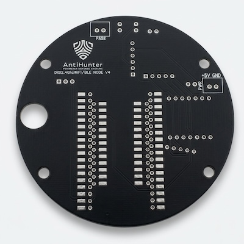 | [AntiHunter - Lectronz Store](https://lectronz.com/products/antihunter-diginode-24ghz-wifible-pcb-only) |   |   |
| 1× | **Seeed XIAO ESP32-S3** (2.4 GHz) *Buy the plain S3 — "Sense" is a different board* | 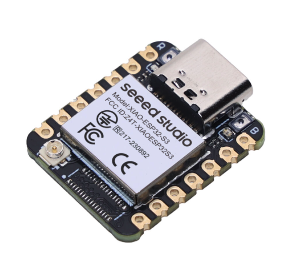 | [Seeed Studio](https://www.seeedstudio.com/XIAO-ESP32S3-p-5627.html) | [Search](https://www.amazon.com/s?k=Seeed+XIAO+ESP32-S3) | [Search](https://www.aliexpress.com/w/wholesale-XIAO-ESP32-S3.html) |
| 1× | **Heltec WiFi LoRa 32 V3.2** *T114 alt — V3.2 preferred · Band: 863–870 EU / 902–928 US* | 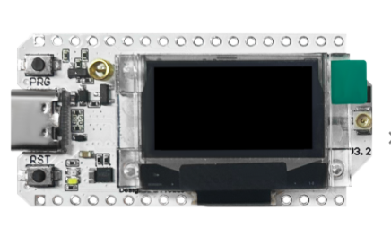 | [Heltec](https://heltec.org/project/wifi-lora-32-v3/) · [Datasheet](https://resource.heltec.cn/download/WiFi_LoRa_32_V3/HTIT-WB32LA_V3.2.pdf) | [Search](https://www.amazon.com/s?k=heltec+v3&i=electronics&crid=2DU09XJ5HC24F&sprefix=heltec+v3%2Celectronics%2C245&ref=nb_sb_noss_1) | [Search](https://www.aliexpress.com/w/wholesale-Heltec-WiFi-LoRa-32-V3.html) |
| 1× | **ATGM336H GPS Module** *AT6558, L1-band, NMEA0183* | 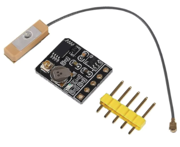 | Commodity (AT6558) | [View](https://www.amazon.com/DWEII-Dual-Mode-Satellite-Positioning-Replacement/dp/B0B68C1W94/ref=sr_1_2?crid=1BIHLTX2D3Q8G&dib=eyJ2IjoiMSJ9._va0qNlb7f2IDJS0x_jvVHX8xcGx6iiLMNmwU0RB_PGok1ekmwTHfY0OI4jTp6s4Imkg8G-eQ6Nl07JPFTtBfchyTWXrSkKQXnUFaH8LTVuTyj6LBpfhVDewZlh-kxQeU1SWopQbhLirJqXIvjwaFo7n_hK0azY7D4k0iiaM06SxYNcpojHe3nNClcBAHLn4W03WiJxNN8etlzRgH1zrg65pv5FkGG7zH9cx24sFjm3eh6gFnbGsmogpGlArcx14VMVpZhjfKPaRL0o6a0lkA-DFXjiKfo2pwRW7-DFueIk.w59Du-qq6cBOpVpC9FWPaRVvfhw2eJ-b_bZN-Hn3y9s&dib_tag=se&keywords=ATGM336H&qid=1780583983&s=electronics&sprefix=atgm336h%2Celectronics%2C276&th=1) | [Search](https://www.aliexpress.com/w/wholesale-ATGM336H.html) · [ElectroDragon](https://www.electrodragon.com/product/gnss-module-atgm336h/) |
| 1× | **DS3231 RTC Module** | 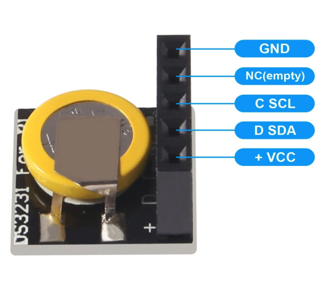 | Analog Devices DS3231 | [View](https://amazon.com/dp/B08X4H3NBR) | [View](https://www.aliexpress.us/item/2251832129568616.html) |
| 1× | **SW-420 Vibration Sensor** *LED is green or red depending on the batch; both work the same* | 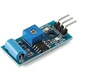 | Commodity | [Search](https://www.amazon.com/s?k=SW-420+vibration+sensor+module) | [Search](https://www.aliexpress.us/w/wholesale-SW%2525252d420.html?spm=a2g0o.productlist.search.0) |
| 1× | **MicroSD SPI Reader Module** | 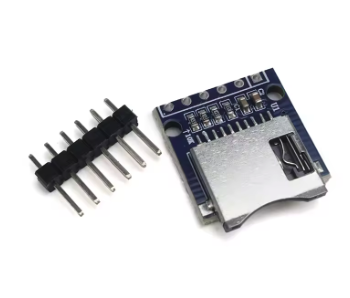 | Commodity | *SD Card Module* | [Search](https://www.aliexpress.com/w/wholesale-micro-sd-card-module-spi.html) |
| 1× | **MicroSD Card — 8 GB, FAT32** *SDHC · see Note 3* | — | [Micro Center](https://www.microcenter.com/search/search_results.aspx?Ntt=8GB+microSDHC) | [Search](https://www.amazon.com/s?k=8GB+microSDHC+card+multipack) | [Search](https://www.aliexpress.com/w/wholesale-8GB-micro-sd-card.html) |

---

## Power & Enclosure

| Qty | Part | Image | MFR | AMZN | ALI |
|:---:|------|:---:|------|------|-----|
| 1× | **Type-C 15W 3A 5V UPS** (2S 18650) *Board ID HW-465A · 88×41×22 mm* | 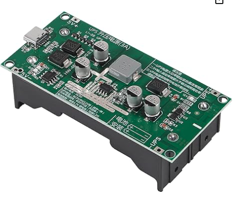 | Commodity (HW-465A) | [DWEII](https://www.amazon.com/dp/B0DCVRXTW8) · [JUZITAO 2-Pack](https://www.amazon.com/dp/B0DNMVSD65) | [Search](https://www.aliexpress.com/w/wholesale-HW-465A-UPS-18650.html) |
| 1× | **Type-C Female Chassis Jack** *Panel mount, 2-pin 22 AWG leads · 14mm panel nut · dust cap · external 5V input* | 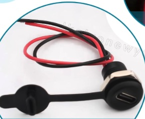 | Commodity | [View](https://www.amazon.com/dp/B0CXLZBD2V) | [Search](https://www.aliexpress.com/w/wholesale-type-c-female-panel-mount-2-pin-waterproof.html) |
| 1× | **KSD9700 Normally Open Thermal Switch** 40°C close temp| 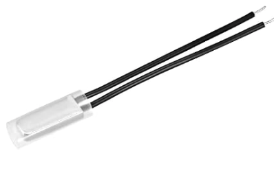 | — | [Search](https://www.amazon.com/s?k=KSD9700+40C+normally+open+thermal+switch) | [Search](https://www.aliexpress.com/w/wholesale-KSD9700-40C-NO.html) |
| 1× | **30mm 5V JST Fan** | 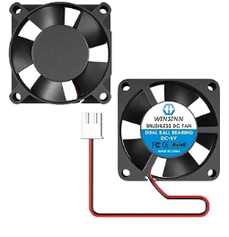 | — | [10mm](https://amazon.com/dp/B08R9HFXTN) · [7mm](https://amazon.com/dp/B0CWD6BY6G) | [Search](https://www.aliexpress.com/w/wholesale-30mm-5V-fan.html) |
| 1× | **3-Pin Mini On/Off Switch** (6mm) | 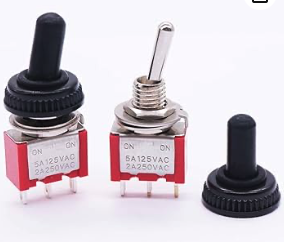 | — | [View](https://www.amazon.com/dp/B07LBNWD52?th=1) | [Search](https://www.aliexpress.com/w/wholesale-mini-switch--waterproof-cap.html) |
| 2× | **JST Power Male Cables** *Switch, power board·  Includes female 2.54 JST socket* | 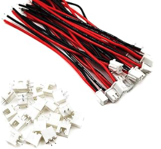 | — | [View](https://amazon.com/dp/B0D6KSMK1Q) | [View](https://www.aliexpress.us/item/3256809537971085.html) |
| 2× | **18650 Cells** *Matched pair, flat-top, from a battery specialist · see Note 1* | — | — | — | — |
| 1× | **Printed Enclosure** *3D-printed · weather-resistant, not waterproof* | — | — | [STLs (Repo)](https://github.com/lukeswitz/AntiHunter/tree/main/hw/Prototype_STL_Files) | — |
| 1× | **TPU Seal Kit** *Housing, USB-C, GPS antenna — grease before fitting* | — | — | [STLs (Repo)](https://github.com/lukeswitz/AntiHunter/tree/main/hw/Prototype_STL_Files) | — |

---

## Antennas

| Qty | Part | Image | AMZN | ALI |
|:---:|------|:---:|------|-----|
| 3× | **U.FL → SMA Pigtail** *10cm, SMA bulkhead — female/jack, see Note 2* | 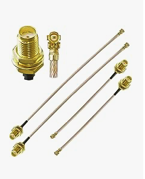 | [Search](https://www.amazon.com/s?k=U.FL+to+SMA+female+bulkhead+pigtail+10cm) | [Search](https://www.aliexpress.com/w/wholesale-ufl-to-sma-female-bulkhead.html) |
| 1× | **6dBi 2.4GHz Antenna** *Wi-Fi/BLE, SMA* | — | [Search](https://www.amazon.com/s?k=6dBi+2.4GHz+SMA+antenna) | [Search](https://www.aliexpress.com/w/wholesale-6dBi-2.4GHz-SMA-antenna.html) |
| 1× | **6dBi LoRa Antenna** *868 EU / 915 US / 923 Asia, SMA* | — | [Search](https://www.amazon.com/s?k=915MHz+LoRa+antenna+SMA) | [Search](https://www.aliexpress.com/w/wholesale-915MHz-LoRa-antenna.html) |
| 1× | **GNSS Antenna — Active L1, SMA** *1575.42 MHz, 28 dB, 3–5V* | 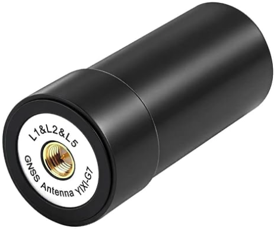 | [View](https://amazon.com/dp/B0FPKPBW7G) | [Search](https://www.aliexpress.us/w/wholesale-gps-helix-l1-antenna.html) |

---

## Fasteners & Hardware

| Qty | Part | Image | AMZN | ALI |
|:---:|------|:---:|------|-----|
| 14× | **M3×3mm Short Heat-Set Inserts** *4.6mm OD, 3mm long (CNC Kitchen M3 short or equal) · see Note 7* | 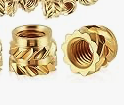 | [Search](https://www.amazon.com/s?k=M3+x+3mm+short+heat+set+inserts) | [Search](https://www.aliexpress.com/w/wholesale-M3-heat-set-insert.html) · [Prusa](https://www.prusa3d.com/product/threaded-inserts-m3-short-100-pcs/) |
| 2× | **M3×15mm Brass Standoffs** *Male-to-female, 6mm male thread* | 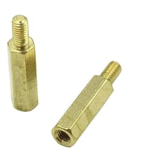 | [View](https://amazon.com/dp/B07WR5ZD8G) | [Search](https://www.aliexpress.com/w/wholesale-M3-brass-standoff.html) |
| 18× | **M3×6mm Screws** (max 6mm heads) *PCB, UPS board, covers and fan* | — | [Search](https://www.amazon.com/s?k=M3+x+6mm+screws) | [Search](https://www.aliexpress.com/w/wholesale-M3x6-screw.html) |
| 5× | **JST 2.54 2-Pin Terminals** |  | [View](https://amazon.com/dp/B0D6KSMK1Q) | [Search](https://www.aliexpress.com/w/wholesale-JST-XH-2.54-2pin.html) |
| 1× | **1/4" Tripod Insert** *1/4-20 threaded* | — | [Search](https://www.amazon.com/s?k=1%2F4-20+threaded+insert+brass) | [Search](https://www.aliexpress.com/w/wholesale-1-4-20-threaded-insert.html) |

### Where each fastener goes

| Location | Insert | Fastener | Qty |
|---|---|---|---|
| PCB posts, main housing, upper two | M3×3mm | M3×6mm screw | 2 |
| PCB posts, main housing, lower two | M3×3mm | M3×15mm standoff | 2 |
| Front cover to main housing wall posts | M3×3mm | M3×6mm screw | 2 |
| Front cover to standoffs | — | M3×6mm screw | 2 |
| UPS board posts, battery housing | M3×3mm | M3×6mm screw | 4 |
| Back cover to battery housing posts | M3×3mm | M3×6mm screw | 4 |
| Fan to front cover, through the fan | — (screw threads into the plastic) | M3×6mm screw | 4 |
| Tripod mount, base | 1/4"-20 | — | 1 |

---

## Builder Notes — read before ordering

1. **Buy the 2× 18650 cells yourself.** The HW-465A UPS holds two cells. No tier includes them. Use a matched pair of flat-top cells from a battery specialist (18650 Battery Store, Battery Junction, IMR Batteries or Illumn). Samsung 35E (3500 mAh) gives the most runtime and Sony/Murata VTC6 handles cold best. Protected flat-tops such as Keeppower 3500 mAh are about 69 mm long, so check they fit the holder. Do not charge the cells below 0°C.
2. **Match the SMA gender.** The GPS, LoRa and Wi-Fi antennas are SMA male and the modules use U.FL. Buy U.FL→SMA pigtails with an SMA female (jack) bulkhead, or the antennas will not thread on.
3. **Use a FAT32 SD card.** Use 8 GB. Cards of 32 GB and more are not recommended. Cards of 64 GB and more come formatted exFAT and need reformatting (untested).
4. **Match the LoRa band to your region and Heltec variant** (EU868, US915 or AS923). A mismatched antenna or board band reduces range.
5. **Choose the airflow direction.** The fan blows toward its labeled side. Face the label toward the cover for exhaust, or toward the board for intake. Assembled units come set to exhaust.
6. **To run the fan full time,** short the two THERMO pins to bypass the KSD9700.
7. **Use the short M3 inserts.** The case holes are sized for M3×3mm inserts with a 4.6mm outside diameter. Longer inserts do not fit the PCB and power board posts. The fan screws thread straight into the plastic and need no inserts.
8. **A battery fuse is optional.** A 2A fast-blow inline fuse between the cells and the UPS board protects against a cell fault. Use a square TE5 radial fuse (Littelfuse 391 series, 2A, part 39112000000) soldered to the power switch (manual 11.3). Automotive blade fuses do not fit in the case. It is not required and not supplied.
9. **The case is not waterproof.** The SMA connectors and the fan vents are not watertight by design. The TPU seals and grease reduce water entry. No IP rating is claimed.
10. **Cases printed before 21 November 2026 have the older holes.** A front cover with no screw bosses around the fan opening is an older print. Older prints take M3 heat-set inserts and M3×4–6mm screws, and M3 screws thread straight into their UPS board posts with no inserts. The M3×3mm short inserts, the UPS post inserts and the fan screws above fit only the current STLs.

> [!IMPORTANT]
> **The RTC and vibration sensor modules need a small pin change** to seat in the PCB.

- **RTC module:** It usually has female headers. Trim and reuse the existing pins, or desolder them and fit male pin headers.
- **Vibration sensor:** Purchased units have inverted 90° headers. Heat all three joints and bend the pins straight (trim the excess), or desolder them and fit standard header pins.
